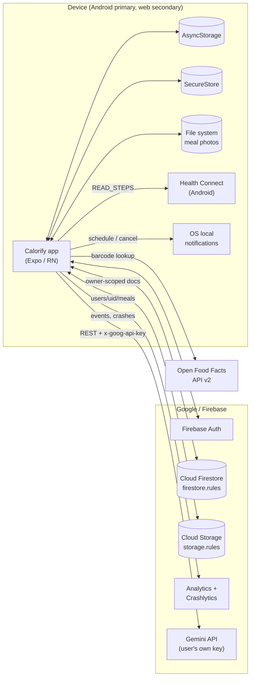
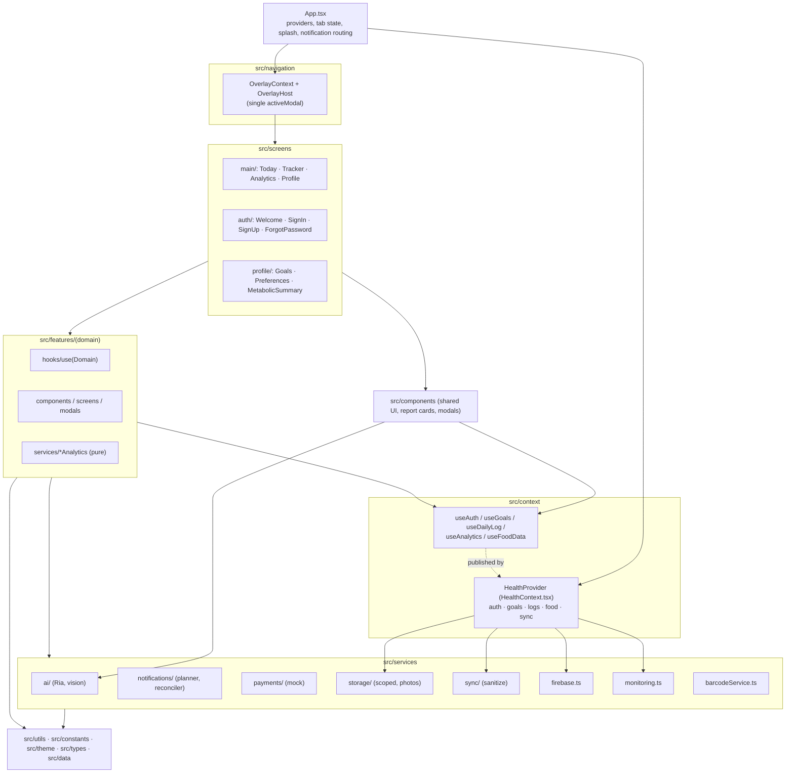
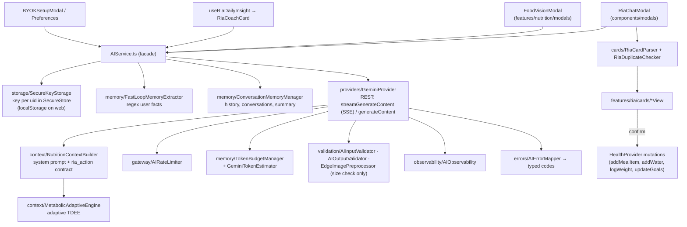
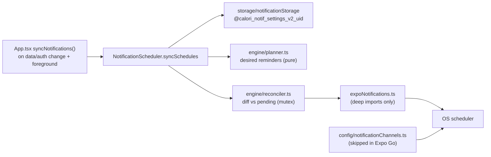

# Calorify — Architecture

> Last verified against the code on branch `cmd-v7` (2026-11-05). The previous version of this file (branch `cmd-v4`) had stale details: model `gemini-2.0-flash`, Poppins headings, Google Sign-In, RevenueCat billing, image resizing, "100+ foods" and "49/49 suites". Those are corrected below.
>
> Companion docs: [CODEBASE_GUIDE.md](CODEBASE_GUIDE.md) (where things are), [DATA_FLOW.md](DATA_FLOW.md) (sequences, storage keys), [BUSINESS_LOGIC.md](BUSINESS_LOGIC.md) (formulas, rules), [TECHNICAL_DEBT.md](TECHNICAL_DEBT.md) (known issues), [DEVELOPMENT_GUIDE.md](DEVELOPMENT_GUIDE.md) (setup, workflow), [DESIGN.md](DESIGN.md) (visual system).

## 1. What the system is

**Calorify** is a calorie and health tracker. The Expo slug and package name are both `calori`. Its parts:

- **Nutrition:** meals are logged by catalog search, custom food, barcode (Open Food Facts) or an AI food photo.
- **Trackers:** water, steps (manual entry plus Android Health Connect) and weight/BMI.
- **Analytics:** reports with weekly, monthly and yearly views.
- **Reminders:** local notifications.
- **Onboarding:** a 16-step wizard that builds a calorie plan with Mifflin-St Jeor.
- **Ria:** an AI nutrition coach that calls Google Gemini directly with the user's own API key (BYOK).

The app has no backend of its own. It uses Firebase Auth, Firestore and Cloud Storage directly from the client, and security lives in `firestore.rules` and `storage.rules`.

| Concern | Technology |
|---|---|
| Runtime | Expo SDK 57, React Native 0.86 (New Architecture), React 19.2, react-native-web |
| Language | TypeScript 6, `strict` (`tsconfig.json` extends `expo/tsconfig.base`), alias `@/*` → `src/*` |
| Native project | Continuous Native Generation: `android/` and `ios/` are gitignored and created by `expo prebuild` / `expo run:*` |
| UI | React Native core components, `react-native-svg`, `react-native-reanimated` 4 + `react-native-worklets`, `expo-image`, `@expo/vector-icons` (Ionicons) |
| State | React Context (`HealthProvider`), with no external store. `zustand` is installed but unused |
| Local persistence | `@react-native-async-storage/async-storage`, `expo-secure-store` (Firebase auth session and the Gemini key), `expo-file-system` (meal photos) |
| Cloud | Firebase JS SDK: Auth (email/password, anonymous), Firestore, Storage |
| Telemetry | `@react-native-firebase/analytics` + `crashlytics`, lazily required through `src/services/monitoring.ts` |
| AI | Gemini REST API (`generativelanguage.googleapis.com/v1beta`), model set in `src/services/ai/config/AIConfig.ts` |
| Device APIs | `react-native-health-connect` (READ_STEPS only), `expo-camera` (barcode), `expo-image-picker`, `expo-notifications` (local only), `expo-haptics` |
| Build | EAS (`eas.json`: development / preview APK / production AAB), Android compile/target SDK 36, min SDK 26, iOS deployment target 16.4 |
| Tests | Jest 29 + `jest-expo` preset + `@testing-library/react-native` |

## 2. System context



## 3. Runtime layers



**Provider tree** (`App.tsx`): `ErrorBoundary` → `SafeAreaProvider` → `HealthProvider` → `OverlayProvider` → `MainApp`.

**Startup** (`App.tsx`):
1. The native splash screen is held with `expo-splash-screen` while fonts load. On web, font CSS is injected.
2. Content mounts after 600 ms.
3. The loading screen stays up for at least 950 ms, then fades out over 300 ms.
4. While `isAuthLoading` is true, or the user is unauthenticated or still onboarding, `WelcomeScreen` renders in place of the tabs.

## 4. Navigation (no router library)

There is no React Navigation and no expo-router.

- **Tabs.** `App.tsx` holds `activeTab: 'today' | 'tracker' | 'analytics' | 'profile'` in state and mounts only the active tab screen. Scroll offsets are kept in refs. `BottomNavBar` switches tabs.
- **Overlays.** `src/navigation/OverlayContext.tsx` holds one `activeModal: ActiveModal | null`. The union in `src/navigation/types.ts` has 12 members:
  - **Rendered by OverlayHost as RN Modals:** `foodLog`, `foodVision`, `barcodeScanner`, `byokSetup`, `notifications`, `avatarPicker`, `riaChat`, `signOutConfirm`.
  - **Rendered by OverlayHost as full-screen `SlideInSubScreen` trackers:** `waterTracker`, `weightTracker`, `stepTracker`.
  - **Declared but unused:** `auth`. Nothing opens it. `App.tsx` manages its own sign-in modal with local state (`authModalVisible`, `authInitialMode`).

  Only one overlay can be open at a time. Opening a second one replaces the first; for example, FoodLog → Barcode → back to FoodLog is done by calling `openModal` again with a prefill.
- **Back handling.** Android back closes the open overlay (`OverlayContext`). With no overlay, `App.tsx` returns to the Today tab. Sub-screens and the onboarding and Welcome stacks register their own `BackHandler` listeners.
- **Nested sub-screens.** Profile → Goals, Preferences, Metabolic Summary, Achievements and Pro use `SlideInSubScreen` (Reanimated `translateX`). The base screen stays mounted.
- **Notification taps.** `App.tsx` routes on `content.data.route`, which can be `food_vision`, `water`, `weight` or `today`. There is no `steps` route.

## 5. State: `HealthProvider`

`src/context/HealthContext.tsx` is about 2,600 lines. It is the only application store, and everything in it is `useState` (no reducer). It owns:

| Area | Contents |
|---|---|
| Auth | `currentUser`, `isAuthenticated`, `isAuthLoading`, `login`, `register`, `loginAnonymous`, `loginDemo`, `logout`, `deleteAccount` |
| Goals | `userGoals`, `updateGoals`, `applyOnboardingPlan`, the streak effect |
| Logs | `dailyLogs`, `selectedDate`, `currentLog`, totals, and the mutations: meals, water, steps, workouts, weight |
| Food | `customFoods`, `foodDatabase` (custom foods plus the 64 bundled `INITIAL_FOOD_DATABASE` items), `addCustomFood`, `deleteCustomFood` |
| Analytics | `weeklyLogs` (rolling 7 days) and `dailyLogs` |
| Sync | AsyncStorage persistence effects, the debounced Firestore push, and the cloud hydration merge |

It publishes five slice contexts so that consumers re-render only for their slice. The context objects and types live in `src/context/{auth,goals,logs,food}/`; all the logic stays in `HealthContext.tsx`.

| Hook | Typical consumers |
|---|---|
| `useAuth()` | `App.tsx`, auth screens, Preferences, AI services |
| `useGoals()` | about 30 files |
| `useDailyLog()` | about 30 files |
| `useAnalytics()` | AnalyticsScreen, report screens |
| `useFoodData()` | FoodLogModal, barcode flow |

The feature hooks (`useNutrition`, `useHydration`, `useMovement`, `useWeight`, `usePro`) wrap these slices and add domain calculations from `features/<domain>/services`.

## 6. Persistence and sync

The data model is offline-first. Every mutation goes through `setDailyLogs`, `setUserGoals` or `setCustomFoods`, and the effects below persist it:

1. **Local first.**
   - The whole `dailyLogs` map is written to AsyncStorage on every change. Signed-in users use `@calori_daily_logs_${uid}`; guests use `@calori_daily_logs_v1`.
   - Goals are written the same way.
2. **Cloud second** (signed-in, non-guest users only).
   - After a 1000 ms debounce, changed dates (plus `selectedDate`) are written with `setDoc(users/{uid}/dailyLogs/{date}, …, {merge:true})`.
   - Goals are written to `users/{uid}`.
   - Custom foods are written immediately to `users/{uid}/customFoods/{id}`.
3. **Hydration on sign-in or cold start** (`fetchAndHydrateUserData`):
   - Reads the user doc, the 90 most recent `dailyLogs` documents and all custom foods.
   - Merges them into local data with per-field rules: meals and activities take the cloud list when it is non-empty, water and steps take the max, weight and step entries always come from the cloud.

   See [DATA_FLOW.md §3](DATA_FLOW.md#3-cloud-hydration-merge) for the exact merge, and TECHNICAL_DEBT TD-C1 for the data-loss risk it carries.

Rules and guards:
- **Security rules are schema validators.** `firestore.rules` checks every document with `keys().hasOnly([...])` allowlists plus range checks. A field that is missing from the allowlist makes the cloud write fail, and the failure is logged only under `__DEV__`. Local saves keep working.
- **Firestore rejects `undefined`.** Payloads go through `sanitizeForFirestore` (`src/services/sync/healthSyncService.ts`).
- **Feature settings** should use `ScopedStorage` (`src/services/storage/scopedStorage.ts`), which builds `@calori_${uid|guest}_${key}`. Several older features still use global keys (see the [DATA_FLOW.md](DATA_FLOW.md#10-storage-inventory) inventory).
- **Dates** are local `YYYY-MM-DD` strings (`src/utils/dateUtils.ts`). `selectedDate` is clamped to today, and the meal, water and weight mutations clamp future dates.

**Two Firebase SDKs**:
- The JS `firebase` SDK (`src/services/firebase.ts`) handles Auth, Firestore and Storage.
  - Auth persistence is a SecureStore adapter whose keys are `fb_auth_<hex>`, because SecureStore allows only `[A-Za-z0-9._-]`.
  - The config comes from `EXPO_PUBLIC_FIREBASE_*` env vars, with a hardcoded fallback in the same file.
- `@react-native-firebase/*` is used only for Analytics and Crashlytics, through `Monitoring`. It no-ops where the native module is absent (Expo Go, web, Jest).

## 7. Ria AI subsystem (`src/services/ai/`)



- **BYOK.** The key is validated with a `generateContent` ping before it is saved. It is stored under `calorify_gemini_byok_api_key_v1_${uid|guest}`. There is no server proxy.
- **Chat turn.**
  1. Facts are extracted from the prompt and saved.
  2. The summary is loaded.
  3. `GeminiProvider.streamChat` builds the system context and streams the reply.
  4. If history has 10 or more messages, a background summary runs.
- **Generative UI.** The model is told to emit fenced `ria_action` JSON blocks. `RiaCardParser` strips them from the visible text, clamps and validates them (Atwater check, safety floors, time-based meal slot, 10-minute duplicate check) and returns a `RiaCard`. Eight card views exist in `src/features/ria/cards/`.
- **"LangChain" naming.** It appears in comments and commit messages only. There is no LangChain dependency.

## 8. Notifications subsystem (`src/services/notifications/`)



- `planner.ts` decides which reminders should exist. It covers meals, water, weight, steps and streak, and applies quiet hours, collision priority and a cap of 60.
- `reconciler.ts` cancels or schedules only what changed, using deterministic IDs (`calori_<type>_<date>[_slot]`).
- **Do not** `import * as Notifications from 'expo-notifications'`. Its entry point registers push tokens at import time, which crashes Expo Go on Android. Use the `expoNotifications.ts` adapter.
- `scripts/patch-expo-notifications.js` runs on `postinstall`. It patches `node_modules/expo-notifications` so the same Expo Go case warns instead of throwing.

## 9. Health Connect (`src/features/health/`)

- `healthConnect.ts` wraps `react-native-health-connect`: SDK status, initialize, permissions, and reading step records and aggregates.
- `healthService.ts` implements three tiers:
  1. A one-time 7-day backfill, gated by the device-global key `@calori_hc_backfill_completed_v1`.
  2. A rolling 48-hour sync.
  3. A single-day fetch for past dates being viewed.
- Results go to `HealthProvider.batchUpdateDailySteps`, which overwrites the day's `steps` and `stepEntries`.
- Sync runs only from `StepTrackerScreen`, on mount and on Connect. Nothing syncs at launch or when the app returns to the foreground.
- `app.json` declares only `android.permission.health.READ_STEPS`.

## 10. Other subsystems

| Subsystem | Location | Notes |
|---|---|---|
| Barcode | `src/services/barcodeService.ts`, `src/hooks/useBarcodeScanner.ts`, `src/components/scanner/` | Open Food Facts v2 lookup. `src/types/barcode.ts` normalizes the product to a `FoodItem` |
| Meal photos | `src/services/storage/mealPhotoService.ts` | Local copy under `documentDirectory/meals/`, upload to `users/{uid}/meals/{id}.jpg`, prune after 30 days |
| Gamification | `src/features/gamification/engine/` | 11 achievement rules, evaluated when AchievementCenterScreen opens. Unlocks are stored under a global key |
| Subscription | `src/services/payments/`, `src/features/subscription/` | **Mock billing:** `PaymentService.purchase` always succeeds and stores the entitlement in AsyncStorage. Pro gates the Analytics monthly and yearly timeframes |
| Onboarding | `src/features/onboarding/` | A 16-step wizard with a persisted draft (`onboarding_draft_v1`). `onboardingCalculator.ts` holds the plan maths. It finishes with `applyOnboardingPlan` |
| Scan limits | `src/features/nutrition/services/scanLimitService.ts` | 5 per day. Used only by onboarding |
| Theme | `src/theme/` | `colors`, `typography`, `spacing`, `icons`, `controls`, `motion`. Code imports subpaths (`@/theme/colors`), not the barrel |

## 11. Module dependency rules

These are observed conventions; follow them.

- `features/*` and `screens/*` reach the store **only** through the slice hooks from `@/context` (or the feature hooks), never through `HealthContext` internals.
- `features/<domain>/services/*` are pure TypeScript with no React. Keep calculations there so they can be unit-tested.
- Each feature exports through `index.ts`. `src/components/index.ts` also re-exports feature components, so **inside a feature, import siblings by relative path**. Importing from `@/components` creates require cycles.
- UI calls AI only through `AIService`. Only `GeminiProvider` talks to the network.
- Notification code imports `expo-notifications` only through `expoNotifications.ts`.
- Health Connect is reached only through `features/health` (Android only). Calls are guarded by `Platform.OS`.
- Known layering exceptions: some analytics services import types from the `@/components/report` UI barrel, and some files use RN `Platform` checks inline (see TECHNICAL_DEBT).

## 12. Directory map (folder level)

Generated, vendored and tooling folders are excluded: `node_modules/`, `android/`, `ios/`, `.expo/`, `dist/`, `coverage/`, `.idea/`, `.agents/`, `scratch/`.

```
App.tsx                      Root: providers, tabs, splash, notification routing, sign-out
index.ts                     registerRootComponent
app.json / eas.json          Expo config (plugins, permissions, SDK levels) / EAS build profiles
firestore.rules              Firestore schema + ownership validation (hasOnly allowlists)
storage.rules                Storage: users/{uid}/meals|avatars, owner-only, <1 MB images
scripts/                     patch-expo-notifications.js (postinstall)
assets/                      Fonts (Urbanist, Kurale, unused Poppins), icons, splash, food & avatar images
src/
  navigation/                OverlayContext, OverlayHost, ActiveModal union
  context/                   HealthContext.tsx (store) + slice context objects/types
  screens/main/              Today, Tracker, Analytics, Profile tab shells
  screens/auth/              Welcome (mode stack + onboarding entry), SignIn, SignUp, ForgotPassword
  screens/profile/           Goals, Preferences (units, BYOK, sign-out, delete), MetabolicSummary
  features/
    nutrition/               HeroCalorieCard, MealSection/MealCard, FoodLogModal, FoodVisionModal, nutritionAnalytics, scanLimitService
    hydration/               WaterTracker card, WaterTrackerScreen, history/report screens, cup/goal/settings modals, hydrationAnalytics
    movement/                MovementTrackerCard, StepTrackerScreen, StepHistory*, StepReportScreen, movementAnalytics
    weight/                  WeightTrackerCard, TodayBMICard, LogWeightScreen, history/report, bmiCalculator, weightAnalytics
    health/                  Health Connect wrapper + sync service (+ unused HealthScreen)
    onboarding/              Wizard + 17 step screens, onboardingCalculator, onboardingDraft, onboardingMigration
    gamification/            AchievementEvaluator, achievementRules, badges, AchievementCenterScreen
    subscription/            usePro, ProPaywallModal, ProBadge, ProMembershipCard, ProGate (unused)
    ria/cards/               8 Ria card views + RiaActionCard
  components/                common/ (ErrorBoundary, SlideInSubScreen, FoodImage…), dashboard/ (RiaCoachCard, TopDateStrip),
                             modals/ (RiaChatModal, BYOKSetupModal, NotificationModal, AvatarPicker, TimePicker),
                             navigation/ (Header, BottomNavBar), profile/, report/ (chart cards), scanner/
  services/
    ai/                      AIService facade + config, context, cards, memory, providers, storage, gateway, validation, errors, observability, types
    notifications/           scheduler, service, adapter, engine/{planner,reconciler}, storage, defaults, types
    payments/                paymentService (mock), entitlementManager
    storage/                 scopedStorage, mealPhotoService
    sync/                    healthSyncService (sanitizeForFirestore)
    firebase.ts, monitoring.ts, barcodeService.ts
  hooks/                     useRiaDailyInsight, useBarcodeScanner
  config/                    notificationChannels
  constants/                 biometricDefaults (BIOMETRIC_DEFAULTS, HYDRATION/MOVEMENT/BMI defaults)
  theme/                     Design tokens
  types/                     DailyLog, UserGoals, FoodItem, AuthUser, barcode types
  data/                      foodDatabase (64 items), avatars
  utils/                     dateUtils, stepHistoryUtils, beverageUtils, haptics
  assets/foodImages.ts       Food image require-map
Scenarios/                   Behavioural test matrices per screen
info/                        UX principles and method notes (e.g. NOTIFICATIONS_SCENARIO_MAP.md)
```

## 13. Verification status (2026-11-05)

| Check | Result |
|---|---|
| `npx tsc --noEmit` | Passes (exit 0) |
| `npm test` | **Blocked.** jest-expo cannot find `@react-native/jest-preset`. It is declared in `package.json` and the lockfile but missing from `node_modules`. `npm install` should restore it |
| `npm run lint` | 500 problems (57 errors, 443 warnings) |
| Test files | 100 files in `__tests__/` folders, against 248 non-test `.ts`/`.tsx` files under `src/` |
