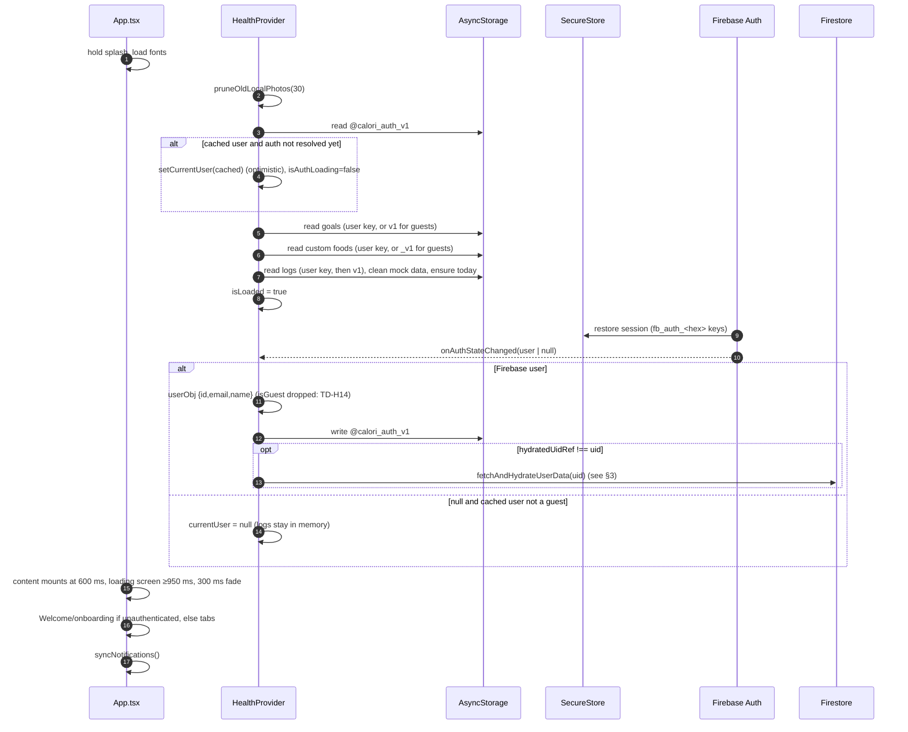
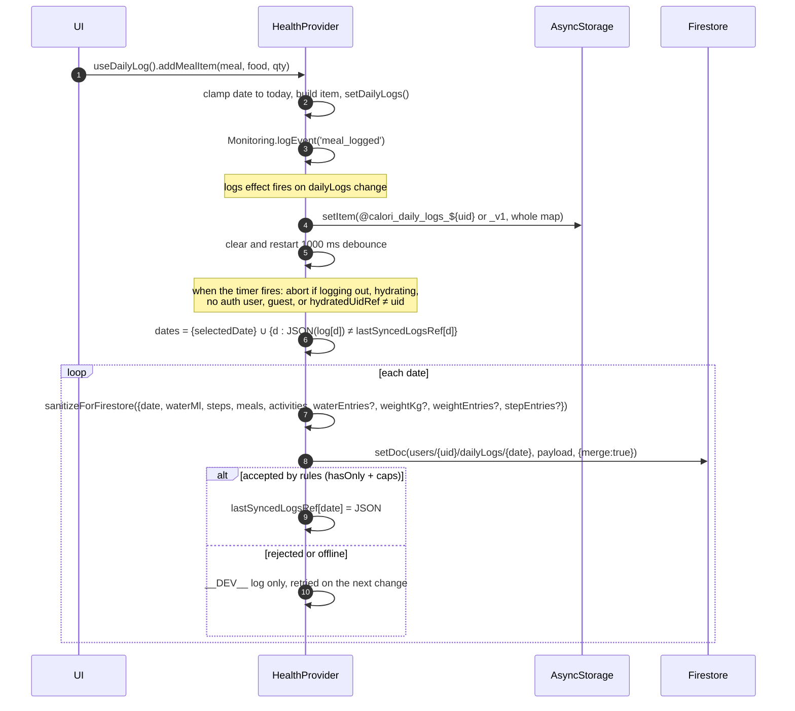
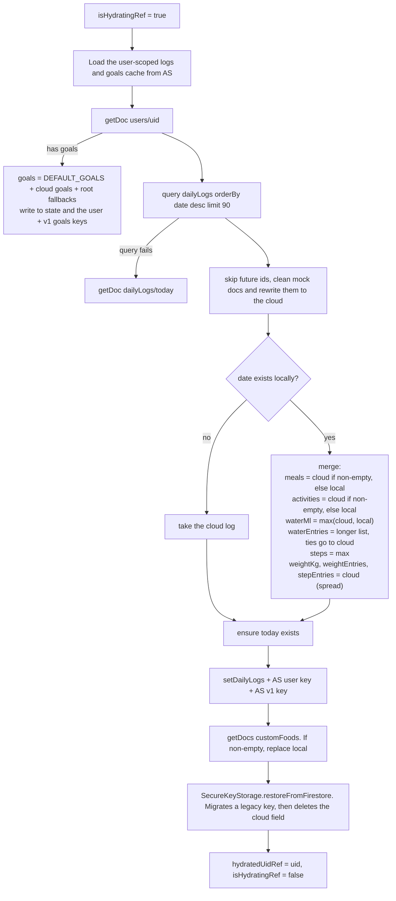
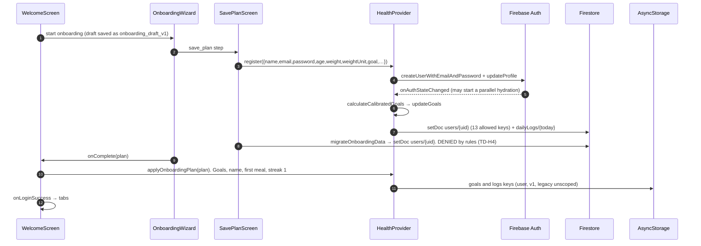
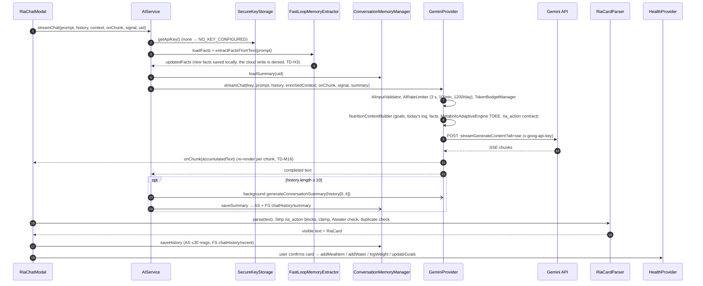
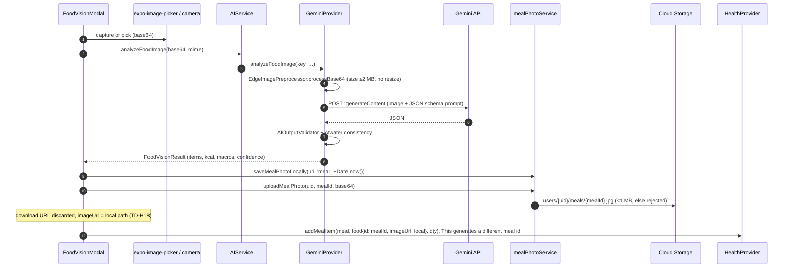
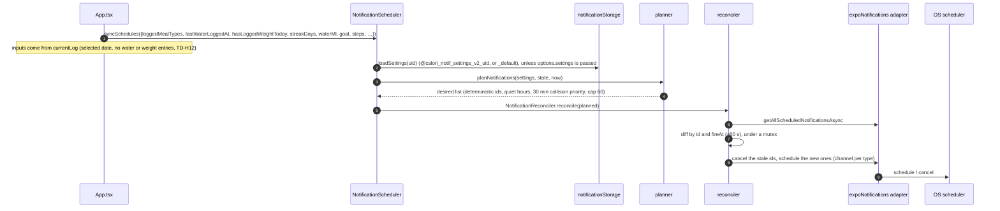
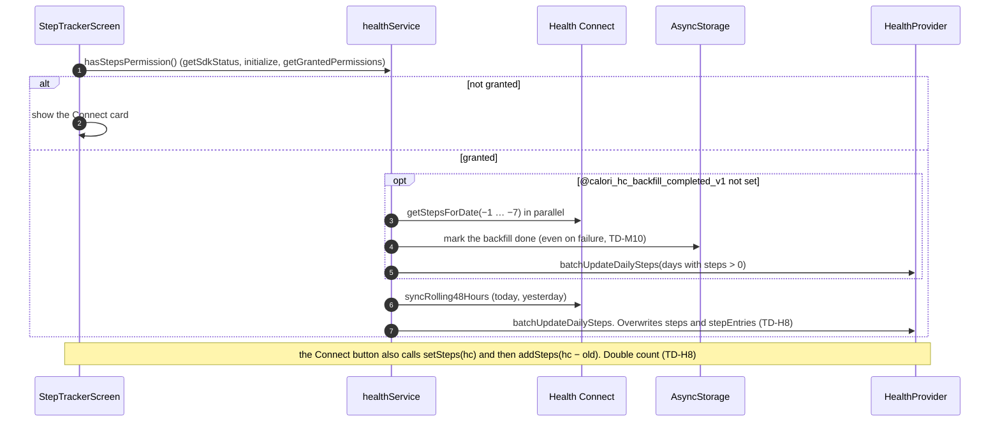

# Calorify — Data Flow

This document covers how data moves between the UI, `HealthProvider`, device storage and Google/Firebase services. Every sequence is traced from code in `src/context/HealthContext.tsx` unless another file is named. Issue IDs (TD-…) refer to [TECHNICAL_DEBT.md](TECHNICAL_DEBT.md).

Participants used in the diagrams:

| Short name | Meaning |
|---|---|
| UI | Screens and components |
| HP | `HealthProvider` |
| AS | AsyncStorage |
| SS | SecureStore |
| FA | Firebase Auth |
| FS | Firestore |
| ST | Cloud Storage |
| GM | Gemini API |

## 1. Cold start

## 2. Logging a change → local save → cloud sync

The goals sync follows the same pattern:
- `updateGoals`, `logWeight`, `updateWeightEntry`, `deleteWeightEntry`, `applyOnboardingPlan` and the streak effect write AsyncStorage immediately.
- After a 1000 ms debounce, it calls `setDoc(users/{uid}, {updatedAt, goals, weight?, weightUnit?, startWeightKg?, heightCm?}, {merge:true})`.
- There is **no** `hydratedUidRef` guard (TD-M3).

Custom foods are not debounced. `setDoc` or `deleteDoc` on `users/{uid}/customFoods/{id}` is issued from inside the state updater.

## 3. Cloud hydration merge

`fetchAndHydrateUserData(uid)`, around lines 309–535:

Consequences (TD-C1):
- Offline meal and activity edits are lost whenever the cloud list is non-empty.
- Deleted water comes back through `max`.
- Weight deletes are undone (TD-M5).

## 4. Authentication flows

### 4.1 Sign-up (the reachable path goes through onboarding)

`SignUpScreen` is not reachable from the current UI. `App.tsx` opens the auth modal only in `'signin'` mode and always passes `onLoginSuccess`.

### 4.2 Sign-in, guest, sign-out, delete

| Flow | Steps |
|---|---|
| Sign-in | `SignInScreen` → `login(email.trim(), pw)` → FA `signInWithEmailAndPassword` → set the user and `@calori_auth_v1` → `await fetchAndHydrateUserData`. The auth listener hydrates as well (TD-M2) |
| Demo guest | "Explore as Guest" → `loginDemo()` → `demo_user_1 {isGuest:true}` in AS only. Data goes to the `_v1` keys. Nothing syncs to the cloud |
| Anonymous guest | `loginAnonymous()` → FA `signInAnonymously` (fallback `guest_${ts}`) → `{isGuest:true}`. The auth listener later overwrites it without `isGuest` (TD-H14) |
| Sign-out (header) | `App.handleConfirmSignOut` → cancel all notifications → `logout()` |
| Sign-out (Preferences) | `logout()` → `onSignOut` → `App.handleSignOutCompleted`. **Notifications are not cancelled** (TD-H13) |
| `logout()` | Set `isLoggingOutRef`, clear `hydratedUidRef`, `SecureKeyStorage.invalidateCache()`, `signOut`. Reset state. `multiRemove` the AUTH, v1 and user keys. After 500 ms, clear `isLoggingOutRef`. The pending debounce is dropped (TD-H15) |
| `deleteAccount()` | Batch-delete `dailyLogs`, `customFoods`, `chatHistory` → delete `users/{uid}` → `deleteAllUserPhotos` (meals) → `deleteUser` → remove the user keys → `removeApiKey()`. This removes the wrong key (TD-H6). If `deleteUser` fails, the data is already gone (TD-H5) |

## 5. Ria chat turn

Errors pass through `AIErrorMapper`, which returns typed codes (invalid key, quota, rate limit, network, non-food photo, …). The UI shows a recovery action for each code.

## 6. AI food photo

## 7. Notification sync

Triggers:
- any change to the dependent data or auth state
- the app returning to the foreground
- `handleConfirmSignOut`, which cancels everything

## 8. Health Connect steps

## 9. Barcode lookup

`BarcodeScannerModal` (expo-camera) → `useBarcodeScanner` → `barcodeService` → Open Food Facts API v2 → `normalizedFoodToFoodItem` (`src/types/barcode.ts`) → `ScannedProductCard` → `addMealItem`. Choosing "enter manually" reopens `foodLog` with `prefillBarcode`.

## 10. Storage inventory

### 10.1 AsyncStorage

| Key | Owner | Scope | Cleared on logout/delete? |
|---|---|---|---|
| `@calori_auth_v1` | HealthContext | global | yes |
| `@calori_daily_logs_v1`, `@calori_user_goals_v1` | HealthContext | global (guest data **and** a mirror of the signed-in user's data) | yes |
| `@calori_custom_foods_v1` | HealthContext | global (read for guests, never written) | yes |
| `@calori_daily_logs_${uid}`, `@calori_user_goals_${uid}`, `@calori_custom_foods_${uid}` | HealthContext | per user | yes |
| `@calori_user_goals_guest`, `@calori_custom_foods_guest` | HealthContext | guest | no |
| `@calori_daily_logs`, `@calori_user_goals` (legacy, unsuffixed) | `applyOnboardingPlan`, `onboardingMigration` | **unscoped** | **no** |
| `@calori_${uid\|guest}_water_cup_pref` | `useHydration` via ScopedStorage | per user | no |
| `@calori_water_cup_pref`, `@calori_custom_cup_presets` | hydration UI | **unscoped** | no |
| `@calori_unlocked_achievements_v1` | AchievementEvaluator | **unscoped** | no |
| `@calori_subscription_entitlement_v1` | PaymentService | **unscoped** | no |
| `@calori_hc_backfill_completed_v1` | healthService | **unscoped** | no |
| `@calori_ai_daily_usage_${utcDate}` | AIRateLimiter | **unscoped** | no |
| `@calori_ai_scans_${date}_${uid\|guest}` | scanLimitService | per user | no |
| `@calori_ria_chat_${u}`, `@calori_ria_summary_${u}`, `@calori_ria_conversations_${u}` | ConversationMemoryManager | per user | **no** |
| `@calori_ria_user_facts_${u}` | FastLoopMemoryExtractor | per user (allergies, diet) | **no** |
| `@calori_ria_daily_insight_${uid}_${date}` | useRiaDailyInsight | per user | no |
| `@calori_notif_settings_v2_${uid\|default}` | notificationStorage | per user | no |
| `@calori_notification_settings_v1`, `@calori_notif_migrated_v2` | notificationStorage (legacy) | unscoped | no |
| `onboarding_draft_v1` | onboardingDraft | **unscoped** | no |

### 10.2 SecureStore

| Key | Owner |
|---|---|
| `fb_auth_<hex(key)>` | `src/services/firebase.ts` (Firebase Auth persistence). Hex encoding satisfies SecureStore's `[A-Za-z0-9._-]` rule |
| `calorify_gemini_byok_api_key_v1_${uid\|guest}` | `SecureKeyStorage` (`localStorage` on web) |

### 10.3 File system
`documentDirectory/meals/*`: local meal photos, pruned after 30 days (`mealPhotoService.pruneOldLocalPhotos`).

### 10.4 Firestore (`firestore.rules`)

| Path | Writer | Allowed shape |
|---|---|---|
| `users/{uid}` | goals sync, `register`, `SecureKeyStorage` (delete field) | `hasOnly`: id, name, email, age, weight, weightUnit, goal, gender, heightCm, startWeightKg, avatarUrl, createdAt, updatedAt, goals (map ≤35 keys), geminiKeyObfuscated. Ranges are checked. `id` is immutable; `createdAt` is immutable once set |
| `users/{uid}/dailyLogs/{YYYY-MM-DD}` | logs sync | The 9 `DailyLog` keys. `date == docId`; waterMl 0–30000; steps 0–250000; weightKg 0–500; list caps (meals 200, activities 100, waterEntries 200, weightEntries 100, stepEntries 200). List contents are not validated |
| `users/{uid}/customFoods/{id}` | `addCustomFood` / `deleteCustomFood` | 21-key allowlist; required name/kcal/macros; `id == foodId` on create |
| `users/{uid}/chatHistory/recent` | ConversationMemoryManager | messages ≤30, updatedAt |
| `users/{uid}/chatHistory/summary` | ConversationMemoryManager | text ≤2000, lastSummarizedIndex int, updatedAt |
| `users/{uid}/riaMemory/facts` | FastLoopMemoryExtractor | **No rule, so denied** (TD-H3) |
| everything else | — | default deny |

### 10.5 Cloud Storage (`storage.rules`)
- `users/{uid}/meals/{id}` and `users/{uid}/avatars/{id}`: the owner can read, write and delete. Writes must be under 1 MB and of type image/jpeg, png or webp.
- No client code writes `avatars/`.
- Everything else is denied.

### 10.6 Outbound network calls

| Destination | From | Auth |
|---|---|---|
| Firebase Auth, Firestore, Storage | JS SDK | Firebase ID token |
| Firebase Analytics, Crashlytics | RN Firebase (native builds only) | app config |
| `generativelanguage.googleapis.com/v1beta/models/{model}:streamGenerateContent` / `:generateContent` | `GeminiProvider` | header `x-goog-api-key` = the user's BYOK key |
| Open Food Facts v2 product API | `barcodeService` | none |
