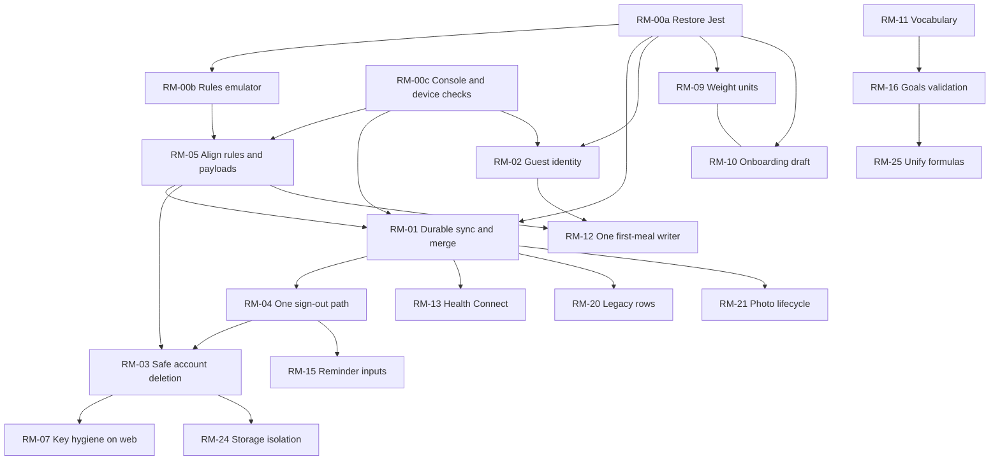

# Calorify — Issue Validation & Implementation Roadmap

Compiled 2026-11-05 on branch `cmd-v7` as the second, read-only analysis pass. **No application code, configuration, rules or dependencies were changed.** Nothing here has been implemented.

This document has five parts:
- **A. Validation of the nine critical areas.** Each area gives its files and functions, the execution flow, the root cause, a reproduction, the impact, the dependencies and a status.
- **B. Dependency and impact analysis** for every confirmed high-priority issue.
- **C. The implementation roadmap** (P0–P3).
- **D. Ordering and the critical path.**
- **E. External validation checklist:** what only a device or the Firebase console can settle.

The issue IDs (TD-…, P-…) are defined in [TECHNICAL_DEBT.md](TECHNICAL_DEBT.md). Line numbers are from this pass and drift as code changes.

**Status legend**

| Status | Meaning |
|---|---|
| **Confirmed (code)** | Follows directly from code that was read. The repro is derived from the code, not from running the app |
| **Confirmed (code), needs runtime check** | The code path is certain; how often it happens or how bad it is depends on SDK, OS or device behaviour |
| **Needs console validation** | Depends on the deployed Firebase project (rules, auth providers, existing documents). **Not validated.** No console access was used in this pass |
| **Potential** | Plausible from the code, but needs a runtime reproduction before it can be called a defect |

> **Repo rules vs deployed rules.** Every rules finding below is about `firestore.rules` and `storage.rules` as committed. Nobody has checked whether the deployed project matches them (P-6). Treat each rules-related verdict as "true for the repo file".

---

## Part A — Validation of the nine critical areas

### V1. Cloud synchronization replaces local data

**Status:** Confirmed (code), needs runtime check for the offline-queue part. **Register:** TD-C1, **TD-C2 (new)**, TD-H14, TD-H15, TD-M2, TD-M3, TD-M5, P-2.

**Files and functions**
- `src/context/HealthContext.tsx`:
  - `fetchAndHydrateUserData` (309-535); the merge is at 426-453
  - cold-start `loadData` (538-645)
  - the auth listener (649-682)
  - the daily-log sync effect (685-746)
  - the goals sync effect (749-809)
  - `login` (1823-1876)
  - `loginAnonymous` (2247-2272)
- `src/services/firebase.ts:57`: `getFirestore(app)`, with no offline persistence configured

**Execution flow**
1. On every cold start, the auth listener sees `hydratedUidRef.current === null`, so it calls `fetchAndHydrateUserData(uid)` (663-665). `login` also calls it (1840), so a sign-in hydrates twice (TD-M2).
2. Hydration reads the user-scoped cache `@calori_daily_logs_${uid}` (319-337), then the root user doc, then `dailyLogs` ordered by `date` desc with `limit(90)` (373-375).
3. For every date present in both places, the merge (440-451) builds `{...cloudLog, meals, waterMl, waterEntries, steps, activities}`:
   - `meals` and `activities`: the cloud array whenever it is non-empty
   - `waterMl`: `max(cloud, local)`
   - `waterEntries`: whichever array is longer
   - `steps`: `max`
   - every other field (`weightKg`, `weightEntries`, `stepEntries`) comes only from `cloudLog`. A local-only weight or step-entry list is **dropped**, not merged.
4. The merged map replaces state (466). It is written to the user key **and to the guest key `@calori_daily_logs_v1`** (519-522).
5. The sync effect then compares each date with `lastSyncedLogsRef`. That ref is never seeded, so every date counts as changed. The effect uploads all of them with `setDoc(..., {merge:true})` (707-743), which makes the cloud-wins result permanent.

**Root cause.** The merge is per field, not per entry, and it has no change tracking. There is no per-entry id merge, no per-date `updatedAt`, no dirty set and no tombstones for deletions. Local changes that never reached the server are indistinguishable from stale local data. The JS SDK's default memory cache does not keep pending writes across an app restart. Failed writes are swallowed (`.catch` only logs in `__DEV__`, 736-738) and never retried.

**Reproductions** (derived from the code)
1. **Offline meal lost.** Signed in, today already has one meal in the cloud.
   1. Go offline and log a second meal.
   2. Kill the app.
   3. Reopen online.

   The cloud `meals` array is non-empty, so it replaces the local one and the second meal is gone.
2. **Deleted meal returns.** Delete a meal and kill the app within the 1 s debounce, or while offline. Reopen: the cloud list still contains the meal, so it comes back.
3. **Deleted water returns.** Remove a water entry offline. `max(waterMl)` and the longer `waterEntries` array both pick the cloud version.
4. **Weigh-in lost.** Log a weight offline on a date the cloud already has a doc for. `weightKg` and `weightEntries` come from `cloudLog` only, so the local weigh-in disappears. TD-M5 is the reverse case: a deleted weight comes back, because `merge:true` keeps the old cloud field.
5. **A rejected day never converges.** A day exceeding a rules cap (TD-M1, or more than 200 Health Connect `stepEntries`, P-2) fails every write. On the next hydrate the old cloud copy wins.

**New: TD-C2, anonymous guest history wiped on the first restart.**
- **Conditions:** Firebase anonymous sign-in is enabled (needs console validation) and a guest was created through SavePlan's "Continue as guest" (`SavePlanScreen.tsx:207` → `loginAnonymous`).
- **Flow:**
  1. During the guest session, `currentUser.isGuest` is true, so local data is saved to `@calori_daily_logs_v1` (687-692) and nothing syncs.
  2. On the next cold start, the auth listener receives the anonymous Firebase user. It rebuilds `currentUser` **without** `isGuest` and writes that to `@calori_auth_v1` (652-660, TD-H14).
  3. `hydratedUidRef` is null, so hydration runs for the anonymous uid. The user-scoped key is empty and the cloud is empty, so `merged = { today: empty }` replaces state (466) and **overwrites `@calori_daily_logs_v1`** (521).
- **Result:** the guest's entire local history is lost. From then on the user is treated as a full user and syncs.
- **Fallback case:** if anonymous auth is disabled, `loginAnonymous` falls back to a local `guest_<ts>` id with no Firebase user and this path does not happen.

**Impact**
- Silent loss of meals, water, weight and step entries. Totals, streak, analytics, reminders and achievements are all derived from these.
- TD-C2 can erase a guest's whole history.

**Dependencies and affected modules.** Every tracker and report that reads `dailyLogs`; `computeStreak`; `NotificationScheduler` inputs; achievements; the Ria context builder (today's log); the onboarding first meal (P-13).

**Local code vs console.**
- The merge behaviour is fully local.
- How often users hit it depends on how often they are offline or kill the app within 1 s. That needs device telemetry.
- TD-C2 depends on the console setting for anonymous sign-in.

---

### V2. Firebase security rules and rejected writes

**Status:** Confirmed against the repo rules. Needs console validation for the deployed rules and existing documents. **Register:** TD-H3, TD-H4, TD-M1, **TD-M39 (new)**, P-5, P-6, P-10.

**Files and functions**
- `firestore.rules`:
  - `isValidUserDoc` (83-106)
  - `isValidDailyLogDoc` (108-120)
  - `isValidCustomFoodDoc` (122-150)
  - the chat validators (152-166)
  - `match /users/{userId}` (173-211)
  - default deny (213-215)
- `src/services/ai/memory/FastLoopMemoryExtractor.ts:190, 214` (`riaMemory/facts`)
- `src/features/onboarding/services/onboardingMigration.ts`: `buildUserProfilePayload` (82-126), `migrateOnboardingData` (132-233)
- `src/context/HealthContext.tsx`: `register` (1981-2087), which writes the root doc first, with `createdAt`

**Findings**
1. **`riaMemory` has no rule (TD-H3).** `users/{uid}/riaMemory/facts` matches no `match` block, so the default deny rejects both the `getDoc` (190) and the `setDoc` (214). Both errors are swallowed. Ria facts exist only locally (`@calori_ria_user_facts_${uid}`) and are lost on reinstall or on a new device.
2. **The onboarding profile write fails, for three independent reasons (TD-H4):**
   - **Keys.** The payload adds `isGuest`, `sex`, `weightKg`, `targetWeightKg`, `units`, `goalIntent`, `struggles`, `activityLevel`, `pace`, `foodStyle`, `mealTimes`, `skipsBreakfast` and `snacks`. None of them is in the `hasOnly` list (85-90).
   - **`createdAt` immutability.** `register` already created the doc with a `createdAt` (2022). The migration sends a new one (123), and the update rule requires it to be unchanged (178-179).
   - **`undefined` values.** `getFirestore` is used without `ignoreUndefinedProperties` (firebase.ts:57), and the payload is not run through `sanitizeForFirestore`. Optional draft fields (`goalIntent`, `mealTimes`, `pace`, …) are often `undefined`, and the SDK rejects the write on the client before the rules see it.
3. **What still reaches the cloud.** `goals` (calorie and macro targets, weight, height) does reach the cloud later through the goals sync effect (749-809) after `applyOnboardingPlan`. What never reaches it is the **questionnaire**: activity level, pace, food style, struggles, meal times, goal intent and the unit choices. That is why MetabolicSummary cannot use the real activity level (TD-M9).
4. **The first-meal day-doc write may fail too.** It sends `updatedDayLog` unsanitized (213). If `imageUrl` is `undefined` (no photo), the SDK rejects it. The meal stays in local storage under the **UTC** date key (178, TD-M11).
5. **Range checks the client doesn't enforce (TD-M1).** These are `waterMl` ≤ 30000, steps ≤ 250000, and the list caps (meals and waterEntries 200, activities 100, weightEntries 100, stepEntries 200). A single out-of-range day is rejected on every sync.
6. **Allowlist gaps in the other direction.**
   - The `goals` map is checked only for key count (≤ 35, line 104). Its values are not validated, so GoalsScreen can store a 400 kcal budget or a 1 cm height.
   - `geminiKeyObfuscated` is still allowed (89, 106), although the client only ever deletes it.
7. **P-5.** `hasOnly` is evaluated on the merged document. If any existing `users/{uid}` doc already carries a field outside the list (for example one written by an older client or added in the console), **every** later merge write to that doc is rejected: the goals sync, the BYOK legacy cleanup, everything. That can only be checked by inspecting production documents.
8. **New (TD-M39): a guest's first meal is written to the cloud.** The daily-log `setDoc` in `migrateOnboardingData` is guarded only by `draft.firstMeal` (`onboardingMigration.ts:176-216`), not by `isGuest`.
   - For an anonymous Firebase guest, the write passes `isOwner`. That breaks the "guests never sync" rule.
   - For a local `guest_<ts>` id there is no auth, so the write is denied and the error is swallowed.

**Reproduction (2).** Complete onboarding with email sign-up. Then look at `users/{uid}` in the console: `struggles`, `activityLevel`, `pace` and the other questionnaire fields are missing. In a `__DEV__` build, the warning `[onboardingMigration] Firestore profile write error` is logged.

**Impact**
- Questionnaire answers and Ria facts are never backed up.
- Rejected days never sync, which then feeds V1.

**Dependencies.** Every synced shape: `DailyLog`, `UserGoals` and the root doc, custom foods, chat docs, `riaMemory`. Changes need the matching edit in `firestore.rules` **and a deployment**.

**Local code vs console.** Not validated in the console. Validation needs:
- the deployed rules text
- the rules-denied metrics in Firebase usage/monitoring
- a sample of real `users/{uid}` docs for P-5

---

### V3. Account deletion and incomplete data cleanup

**Status:** Confirmed (code). How often `requires-recent-login` occurs is Firebase SDK behaviour; confirm it on a device. **Register:** TD-H5, TD-H6, TD-H7, TD-H13, TD-M7.

**Files and functions**
- `src/context/HealthContext.tsx`: `deleteAccount` (2132-2234)
- `src/screens/profile/PreferencesScreen.tsx`: the delete handler (~384-396), which calls `onSignOut`
- `App.tsx`: `handleSignOutCompleted` (411-414)
- `src/services/storage/mealPhotoService.ts`: `deleteAllUserPhotos` (147-163)

**Execution flow (current order)**
1. Batch-delete the `dailyLogs`, `customFoods` and `chatHistory` subcollections (2141-2158). Errors are logged and the flow continues.
2. `deleteDoc(users/{uid})` (2162).
3. Delete Storage `users/{uid}/meals/*` (2169). This is skipped for anonymous users (mealPhotoService 150).
4. `deleteUser(fbUser)` (2176). **On failure the function returns an error here** (2177-2190).
5. Remove the three user-scoped AsyncStorage keys (2194-2196).
6. `SecureKeyStorage.removeApiKey()` (2200), which targets the wrong key (V4).
7. Reset state (2212-2215; `customFoods` is **not** reset) and remove `@calori_auth_v1`, `_daily_logs_v1` and `_user_goals_v1` (2217-2221).

**Root causes**
- **Destructive steps run before the step most likely to fail.** Firebase rejects `deleteUser` with `auth/requires-recent-login` when the last sign-in is not recent, which is the normal case for an existing user.
- **On that failure:**
  - Cloud data is already gone, but the account and the local cache remain.
  - `hydratedUidRef` is null.
  - The goals effect has no hydration guard (TD-M3), so it recreates the root doc on the next goals change.
  - On the next cold start, hydration finds the cloud empty and keeps the local data. The sync effect then **re-uploads every local date**, so the "deleted" data reappears.
  - If the user instead follows the error message ("sign out and sign back in"), `logout` removes the per-user caches (2117-2121). The re-hydrate then finds both the cloud and the cache empty, so **all data is gone while the account still exists**.
  - Calling `deleteUser` first does not fix this on the client. The JS SDK signs out at the end of `delete()`, so the Firestore deletes that follow would run unauthenticated and be denied. The fix has to reauthenticate first (Part B3).
- **Incomplete inventory.** The function erases only the keys it knows about. These survive:
  - **Firestore:** `riaMemory/facts` (no rule, so it can't be deleted; if a console rule exists, it would survive).
  - **Local, per uid:** `@calori_ria_chat_`, `_summary_`, `_conversations_` and `_user_facts_` (the facts include allergies and conditions); `@calori_ria_daily_insight_<uid>_<date>`; `@calori_ai_scans_<date>_<segment>`; `@calori_notif_settings_v2_<uid>`.
  - **Legacy unscoped `@calori_daily_logs` and `@calori_user_goals`.** These are written by `applyOnboardingPlan` (2309, 2368) and the migration (171, 208), never read and never removed.
  - **Device-global keys** (V8): achievements, entitlement, Health Connect backfill flag, cup prefs, onboarding draft.
  - **The Gemini key** (V4).
  - **Scheduled notifications.** PreferencesScreen → `onSignOut` → `handleSignOutCompleted` does not cancel them (TD-H13).
  - **The analytics and Crashlytics user id.** `Monitoring.setUserId(null)` is a no-op (TD-M7).
  - **The `customFoods` in memory.** They stay visible to the next guest in the same session and are re-saved to `@calori_custom_foods_guest` by the effect at 811-815.
- **Correction to TD-H7:** no code uploads avatars to Storage (`avatars/` exists only in `storage.rules`), so "Storage `avatars/` not removed" is not a live gap today.

**Reproductions**
1. **Data deleted, account kept.** Sign in, wait past the recent-login window (hours or days in practice), then Preferences → Delete account. You get the error "please sign out and sign back in". The data is already gone from the cloud. Restart the app and the local data is re-uploaded.
2. **Data left behind after a successful delete.** Sign in, chat with Ria ("I'm allergic to peanuts"), then delete the account successfully. AsyncStorage still holds `@calori_ria_user_facts_<uid>` with the allergy, and reminders keep firing.

**Impact**
- Account-integrity and privacy failure: the "delete" is partial, and can reverse itself.
- Personal health data remains on the device after deletion.

**Dependencies.**
- Auth (reauthentication UI is needed)
- `mealPhotoService`, `SecureKeyStorage`, `ConversationMemoryManager`, `FastLoopMemoryExtractor`, `NotificationScheduler`, `PaymentService`, `AchievementEvaluator`, `onboardingDraft`, `ScopedStorage.clearUserScope` (exists, unused)
- PreferencesScreen and App sign-out wiring

**Local code vs console.** The order and the missing keys are local facts. Whether a `riaMemory` rule exists in the deployed project, and whether a Cloud Function or extension cleans up on user deletion, needs console validation. The repo contains no Cloud Functions.

---

### V4. Gemini API key storage and deletion

**Status:** Confirmed (code). **Register:** TD-H6, TD-M14, **TD-M40 (new)**.

**Files and functions**
- `src/services/ai/storage/SecureKeyStorage.ts`:
  - `getStorageKey(uid?)` (8-13): it defaults to `auth.currentUser?.uid || 'guest'`
  - `getApiKey` (65-88)
  - `saveApiKey` (94-115)
  - `removeApiKey()` (120-149): takes **no uid**
  - `invalidateCache` (173-176)
  - `restoreFromFirestore(uid)` (182-223)
- `HealthContext.tsx`: logout 2094 (`invalidateCache` only); `deleteAccount` 2176 (`deleteUser`) then 2200 (`removeApiKey`); hydration 525 (`restoreFromFirestore`)
- `src/services/ai/AIService.ts:29-64`: save, get, remove, used by `BYOKSetupModal` and PreferencesScreen

**Root cause.** The storage key is derived from ambient auth state when the call happens, not from an explicit uid. By the time `deleteAccount` calls `removeApiKey()`, `deleteUser` has signed the user out, so `getStorageKey()` resolves to `calorify_gemini_byok_api_key_v1_guest`. The real key (`…_<uid>`) is never deleted. The legacy Firestore cleanup inside `removeApiKey` is skipped for the same reason, but the root doc is already deleted by then.

**Other behaviour verified**
- **Logout** keeps the key on the device, under the user's uid, so that signing in again restores it. This is intended (2093 comment). The in-memory cache is invalidated, so another account on the same device cannot read it.
- **Web.** The key is stored in **plain `localStorage`** (71-74, 102-105), which any script on the origin can read. The UI calls it "encrypted" (TD-M14).
- **`restoreFromFirestore`** runs on every hydration. It does an extra `getDoc` per sign-in or cold start and migrates a legacy base64 `geminiKeyObfuscated` field if one is present. The rules still allow that field (V2.6).
- **Removing the key from Preferences while signed in** uses the current uid, so it is correct on native.
- **New (TD-M40): on web, the key cannot be removed.** BYOK Disconnect asks for confirmation with `Alert.alert` (`BYOKSetupModal.tsx:136-157`). In react-native-web, `Alert.alert` is an empty function, so the disconnect handler never runs.

**Reproduction.** Sign in (with a recent login), add a Gemini key, then Delete account. The deletion succeeds. SecureStore (Android Keystore-backed) still holds `calorify_gemini_byok_api_key_v1_<old uid>`. No UI path can reach it again, because uids are not reused.

**Impact**
- A credential the user believes was deleted remains on the device.
- On web it also remains in plain text.
- It is not readable by another account through the app, so this is a privacy and compliance issue rather than a cross-account leak.

**Dependencies.** `AIService`, `BYOKSetupModal`, PreferencesScreen, the `deleteAccount` order (V3).

**Local code vs console.** Fully local. Whether old `geminiKeyObfuscated` fields remain in production docs needs console validation.

---

### V5. Health Connect step aggregation and duplicate counting

**Status:** Confirmed (code). The Health Connect data shapes (record counts, aggregate vs records) need a device check. **Register:** TD-H8, TD-M10, P-1, P-2, **TD-H33 (new: transient read errors zero today's steps)**.

**Files and functions**
- `src/features/movement/screens/StepTrackerScreen.tsx`:
  - `checkInitialStatus` (79-137), which runs once per mount (139-143)
  - lazy past-day fetch (146-172)
  - `handleConnectHealth` (183-276)
  - delete wiring (332)
- `src/context/HealthContext.tsx`: `addSteps` (1257-1277, writes to `selectedDate`); `removeStepEntry` (1279-1304); `batchUpdateDailySteps` (1306-1341)
- `src/features/health/healthService.ts`:
  - `getStepsForDate` (64-93): returns `{steps: 0}` on **any** error
  - `syncRolling48Hours` (110-130)
  - `backfillPastSevenDays` (132-152): marks the backfill complete regardless of the result
  - the global flag `@calori_hc_backfill_completed_v1` (13)

**Root causes**
1. **Double count on Connect.**
   - `batchUpdateDailySteps([rolling.today])` sets today's steps to the Health Connect total (233-244).
   - Then `addSteps(todayCount − currentLog.steps)` (252-255) adds the difference again. `currentLog` is the stale closure value from before the batch update.
   - `addSteps` also targets **`selectedDate`**, so connecting while viewing another day adds the difference to that day.
2. **Every tracker mount overwrites today.**
   - `rolling.today` is always pushed, even when it is 0 (109-111).
   - `batchUpdateDailySteps` assigns `steps` outright (1330-1334), and replaces `stepEntries` whenever Health Connect returns records (1324-1325).
   - Manual steps added in the app are never written to Health Connect, so they vanish the next time the tracker opens.
   - When Health Connect has no records, manual `stepEntries` are kept while `steps` is overwritten, so the entries no longer add up to the total.
3. **New: a transient Health Connect error sets today to 0.** `getStepsForDate` catches and returns `{steps: 0, records: []}` (88-91). `syncRolling48Hours` does not throw, so the `catch` fallback (121-124) never runs, and 0 is written for today.
4. **Backfill.** It is marked done even if every read failed, once per device, not per user (TD-M10). It overwrites days −1 to −7 for whichever user is signed in.
5. **Deletes.** Synthesized sessions (shown when there are no stored entries) have ids that are not in `stepEntries`, so deleting one deducts 0 and the row comes back. The "View All" delete always targets `selectedDate` (332).
6. **Sync happens only while StepTrackerScreen is mounted.** There is no launch or foreground sync (TD-M10).

**Reproductions**
1. **Double count.** Today shows 0 steps and Health Connect has 5,000. Tap Connect. Today becomes 10,000 (5,000 set, then +5,000 added).
2. **Manual steps lost.** Add 3,000 steps manually; Health Connect has 1,000. Close the tracker and open it again: today shows 1,000.
3. **Steps zeroed.** Revoke the permission mid-session, or let a Health Connect read throw. Open the tracker: today is 0.

**Impact.** Steps feed `totalBurned` at 0.04 kcal/step, which feeds `remainingCalories`. They also feed the step reminders (`currentSteps`), the streak (activity), analytics and achievements, and are synced to the cloud, where V1 makes the error stick.

**Dependencies.** `features/health` (Android only), `features/movement` (screen, history card and modal, `stepHistoryUtils`), HealthContext step mutations, rules (`stepEntries` ≤ 200, P-2), notifications.

**Local code vs console.** Local, plus device behaviour (Health Connect aggregate vs records, record counts per day). Product decision needed: should Health Connect replace or merge with manual steps (open question 1)?

---

### V6. Incorrect calorie and weight calculations

**Status:** Confirmed (code) for every item below. **Register:** TD-H1, TD-H9, TD-H10, TD-H11 (refined), TD-H19 (✔ now), TD-M9, TD-M21, plus new items TD-H24 to TD-H28, TD-H31, TD-H32 and TD-M31.

| # | Defect | Root cause and location | Repro | Impact |
|---|---|---|---|---|
| a | **Ria meal card: shown total ≠ logged total** (TD-H1) | The card sums `item.kcal` (`RiaMealCardView.tsx:36-39`); confirming calls `addMealItem(slot, {calories: item.kcal}, item.qty)` (`RiaChatModal.tsx:432-452`), which multiplies by `qty` (`HealthContext.tsx:934`). The prompt example uses `qty: 1` and says macros must equal "reported kcal" (`NutritionContextBuilder.ts:89, 154`), so the contract doesn't say per-unit or total | The model returns `{qty: 2, kcal: 500}`: the card shows 500 and the log gets 1,000 | Wrong intake. **Also:** Ria logs to `selectedDate`, so logging while browsing a past day writes to that day |
| b | **lbs stored as kg** (TD-H10) | `WeightSelectionScreen` returns the value **in the displayed unit** (43, 140); the wizard calls `setWeightKg(val)` (`OnboardingWizardScreen.tsx:465`). `applyOnboardingPlan` (2291-2293) persists it as kg. **Correction:** `register`'s ÷2.20462 (1899) currently produces the *right* kg, because the number it gets really is lbs. Fixing the screen alone would turn it into a double conversion, so both must change together | Choose lbs and pick 176: `weightKg` = 176. The plan's BMR is inflated by about 960 kcal, TargetWeight shows "Starting at 388 lbs", and going back shows "176 kg" | Wrong plan, BMI and water goal for every lbs user |
| c | **Onboarding drag input broken in imperial units** (**new TD-H25**) | Weight (86-124) and Height (138-176) create the `PanResponder` once in `useRef`; `onPanResponderMove` closes over the first render's `unit` ('kg'/'cm') and `updateWeight`/`updateHeight` | Height in ft: any drag snaps to 100 cm. Weight in lbs: a drag from 154 lbs jumps to 155 kg / 342 lbs | Imperial users cannot set height or weight by dragging on Android, the primary input |
| d | **Onboarding draft saved one step stale** (**new TD-H26**) | Each `onContinue` calls `setX(val)` then `pushStep(next)`; `pushStep`'s `useCallback` closure still holds the previous render's values (204-248) | Pick age 15, kill the app on the next screen, resume: age is back to 24, the teen guard is bypassed and the deficit plan is offered | Wrong plan after resume. The safety guard can be defeated |
| e | **Teens choosing "Build muscle" get a surplus** (**new TD-H27**) | `onboardingCalculator.ts:116` forces maintenance only for `'lose_weight'` | A 15-year-old picks Build muscle and gets +300 kcal and 2.2 g/kg protein | Contradicts the stated maintenance policy for 13–17 year-olds |
| f | **Target weight not validated against direction** (**new TD-H28**) | `TargetWeightScreen` clamps only to 30–250 kg (102-130); `isLoss` changes labels only. The BMI 18.5 floor applies only to loss, and no underweight guard exists | Goal Lose, target set above current: the screen says "Lose 3 kg" and the plan still applies a deficit | Contradictory plans; an underweight user can be put into a deficit |
| g | **Barcode: per-100 g calories logged as one serving** (TD-H19, ✔) | `normalizedFoodToFoodItem` sets `calories = caloriesPer100g` and `servingUnit = servingSize` (`src/types/barcode.ts:44-46`). `ScannedProductCard` (132-135) and `BarcodeScannerModal:82` multiply per-100 g values by a "servings" multiplier while showing serving grams (152-156) | A 30 g serving of a 500 kcal/100 g product is logged as 500 kcal; the correct value is 150 | Wrong intake for scanned products. The test fixture uses `'100 g'`, which hides the bug |
| h | **Step-duration chart plots body weight** (TD-H9, ✔ earlier) | `calculateStepMetrics(steps, userWeightKg)` passes weight as the duration argument (`movementAnalytics.ts:59`) | Any day: the duration bars equal weight in minutes | Wrong report |
| i | **Goal vocabulary split** (TD-H11, refined, **downgraded to Medium**) | Onboarding and `applyOnboardingPlan` store `'lose_weight'`/`'gain_muscle'` (2297); `calculateCalibratedGoals` (1906, 1924, 1928) and `HeroCalorieCard.tsx:83-91` compare `'lose'`/`'gain'`. `register` (called from SavePlan with `draft.goal`) therefore writes maintenance ×1.375 goals; `applyOnboardingPlan` overrides them only at `handleFinish`, after the paywall and permissions steps | Onboard with "Lose weight": the Today card says "Daily Goal", never "Weight Loss". Killing the app during the paywall leaves maintenance goals (P-e) | Mislabelled goal; a window with wrong goals |
| j | **Sex vocabulary split** (**new TD-M31**) | Onboarding stores `'prefer_not_to_say'` (2296); `calculateCalibratedGoals:1912` and `MetabolicSummaryScreen:25-26` test for `'other'` and fall through to the male +5 | Pick "prefer not to say": the Summary BMR is 83 kcal higher than onboarding's | Inconsistent numbers |
| k | **MetabolicSummary disagrees with the plan** (TD-M9, refined) | Fixed ×1.375 (`MetabolicSummaryScreen.tsx:30`), no clamps, a 178 cm fallback, no surplus case. The real activity level is never persisted (V2.3) | 80 kg / 180 cm / 30 y, moderately active, losing: onboarding gives a 552 kcal deficit (0.50 kg/week); the Summary shows 241 kcal (0.22 kg/week) | Contradictory guidance |
| l | **GoalsScreen accepts anything** (**new TD-H32**) | `handleSave` (`GoalsScreen.tsx:97-112`) does `parseInt(x) \|\| old`: negatives pass, 0 is impossible, and there are no adult floors and no height or weight bounds. The `goals` map is not value-checked by the rules | Height 1 → BMI ≈ 742,000; budget 400 → saved and synced | Bypasses the 1200/1500 kcal clinical floors that onboarding and `RiaCardParser` enforce. Its presets also fail their own macro check (TD-M9) |
| m | **Weight analytics** (TD-M21) | Target falls back to the current weight; monthly and yearly buckets are flat; `avgWeightKg` is the current weight (`weightAnalytics.ts:44`) | Any user without a target | Wrong report; a test asserts the bug |
| n | **Duplicate first meal** (**new TD-H31**, was P-13) | `migrateOnboardingData` logs the first meal under the **UTC** date (`onboardingMigration.ts:178`); `applyOnboardingPlan` injects it under the **local** date and dedupes only within that date (`HealthContext.tsx:2349-2360`) | US Pacific, onboard at 19:00 with a photo meal, sign up, finish, relaunch: the meal appears today and again tomorrow (the cloud copy is future-dated, so hydration skips it until that day). India: the same happens between 00:00 and 05:29 | Double-counted calories. The Firestore copy survives only if `setDoc` succeeds, which is likely for photo meals because `imageUrl` is then defined |
| o | **Onboarding "AI scan" silently invents the meal** (**new TD-H24**) | `FirstMealWinScreen.tsx:228-257` calls `incrementDailyScan()` first, then on **any** error (no BYOK key, which is the normal case during onboarding; offline; non-food photo) substitutes `starterFoods[0]` with the user's photo attached. `analysisError` is set but never rendered | Fresh install, "Scan with AI Vision", take a photo: the review shows "2 Rotis with Dal & Sabzi" with no error | Fabricated nutrition presented as the user's meal, and a free scan used up |

**Dependencies.**
- Onboarding: the wizard, the step screens, `onboardingCalculator`, `onboardingDraft`, `applyOnboardingPlan`, `register`, the migration
- Nutrition: barcode service and card, `addMealItem`
- Ria: parser, chat modal, card view
- Movement and weight analytics
- Profile screens

**Local code vs console.** All local. The Ria `kcal` semantics (open question 9) and the canonical TDEE model (open question 2) are product decisions.

---

### V7. Reminder scheduling and cancellation

**Status:** Confirmed (code). **Register:** TD-H12, TD-H13, TD-M18, and new TD-H30, TD-M32, TD-M33, TD-M36, TD-M37 and TD-L16.

**Files and functions**
- `App.tsx`: the input memos (100-115), `syncNotifications` (118-147), the data/auth effect (150-153), the foreground effect (156-166), `handleConfirmSignOut` (404-409), `handleSignOutCompleted` (411-414)
- `HealthContext.tsx`: the `currentLog` memo (837-846)
- `src/screens/profile/PreferencesScreen.tsx`: direct `NotificationScheduler.syncSchedules` calls from the settings toggles (132-292); `logout` (378) and `deleteAccount` (387), each followed by `onSignOut`
- `src/services/notifications/notificationScheduler.ts`: `cancelAllAndReset` (176-179)
- `storage/notificationStorage.ts`: `resetSettings` (180-184)

**Root causes**
1. **Wrong day.** The planner input comes from `currentLog`, which is the **selected** date's log, not today's.
2. **Stripped fields.** The `currentLog` memo keeps only `date`, `meals`, `waterMl`, `steps` and `activities`. As a result:
   - `currentLog.waterEntries` is always undefined, so `lastWaterLoggedAt` is always undefined.
   - `currentLog.weightKg` and `weightEntries` are always undefined, so `hasLoggedWeightToday` is always false.
3. **Sign-out without cancellation.** Only the header sign-out (`handleConfirmSignOut`) calls `cancelAllAndReset`. Sign-out and account deletion from Preferences go through `handleSignOutCompleted`, which does not. After sign-out `isAuthenticated` is false and `syncNotifications` returns early (120), so nothing ever removes the scheduled reminders.
4. **New (TD-L16).** `cancelAllAndReset` also **deletes the user's notification settings** (`resetSettings`). A user who signs out from the header and back in loses their reminder customization. Whether that is intended is undecided.
5. **Reconciler** diffs only `fireAt`, so changed copy is never rescheduled (TD-M18). For example, the 17:30 "Goal Crushed" step copy never replaces the walk prompt that was already scheduled.
6. **New (TD-H30): every settings change reschedules from partial input.**
   - PreferencesScreen's seven `syncSchedules` calls (132-292) pass only `settings`, `streakDays` and `hasLoggedMealsToday`.
   - `notificationScheduler.ts:135-138` turns that flag into `loggedMealSlots = ['lunch']`, and without water stats the planner treats the water goal as unmet.
   - After any toggle:
     - breakfast and dinner reminders come back even if those meals are logged
     - lunch is dropped even if it isn't logged
     - water reminders come back after the goal is met
   - App's full sync runs again only when its own dependencies change or the app returns to the foreground.
7. **New (TD-M32): two notification-settings records.**
   - `HydrationSettingsModal` (36, 56, 80) and the wizard's `handleFinish` (289) call `NotificationStorage` without a uid, so they write `@calori_notif_settings_v2_default`.
   - Preferences and App read `_<uid>`.
   - So the onboarding meal times and the hydration interval never reach a signed-in user's schedule.
   - Separately, Preferences' water toggle always writes `intervalMinutes: 120` (129).
8. **New (TD-M33): the streak reminder fires for everyone.**
   - `computeStreak` never returns less than 1 (`HealthContext.tsx:158`), so the planner's `streakDays > 0` skip (`planner.ts:247`) never applies.
   - A brand-new user with no meals gets "Keep your streak alive" every evening.
   - The streak counts water and steps, but the reminder only checks meals, so a user whose streak is already safe still gets it.
9. **New (TD-M36): permission and conflict handling is invisible to the user.**
   - The toggles ignore the `requestPermission` result and stay on when permission is denied. On web nothing is ever scheduled.
   - The test notification reports success even when `scheduleNotification` returned null.
   - Quiet hours silently suppress the 17:30 steps and 21:00 streak reminders; warnings exist only for meals and weigh-in.
   - The 30-minute collision rule silently drops a weigh-in reminder set for the same time as breakfast.
10. **New (TD-M37): water reminders leave long gaps.**
    - After a drink, the planner skips fixed slots instead of moving the next reminder to "last drink + interval". Lunch then knocks out 13:00, which leaves gaps of about 6 hours.
    - `lastWaterLoggedAt` is set with `Date.now()` even when water is logged for a past day (`HealthContext.tsx:1045`), so back-filling yesterday suppresses today's reminders.

**Reproductions**
1. Enable the weight reminder. Log a weigh-in today. The weigh-in reminder still fires, because `hasLoggedWeightToday` is false.
2. Browse to yesterday, which has meals logged. Today's meal reminders are suppressed, because the input says meals were logged.
3. Preferences → Sign out. Reminders keep firing, and a tap routes into the signed-out app.

**Impact.** Wrong or spurious reminders, and reminders that keep coming after sign-out or account deletion (privacy: reminder text can reference health goals).

**Dependencies.** The `currentLog` shape (consumed by many screens; widening it is safe), App, PreferencesScreen, `NotificationScheduler`, the planner and reconciler (pure, tested).

**Local code vs console.** Local. OS delivery (exact alarms, Doze) needs a device check.

---

### V8. User-specific storage isolation

**Status:** Confirmed (code). The cross-account display path in (3) is **Potential** (needs a runtime repro). **Register:** TD-M6, TD-H7, TD-H14, **TD-H29 (new)**, **TD-M34 (new)**.

**Key inventory** (AsyncStorage unless noted)

| Scope | Keys |
|---|---|
| Per uid (correct) | `@calori_daily_logs_<uid>`, `@calori_user_goals_<uid>`, `@calori_custom_foods_<uid>`; `@calori_ria_chat_/summary_/conversations_/user_facts_<uid>`; `@calori_ria_daily_insight_<uid>_<date>`; `@calori_ai_scans_<date>_<segment>`; `@calori_notif_settings_v2_<uid>` (falls back to `_default` without a uid); SecureStore `calorify_gemini_byok_api_key_v1_<uid>` |
| Guest / "active" keys that **also receive signed-in users' data** | `@calori_daily_logs_v1` and `@calori_user_goals_v1`. Hydration writes the signed-in user's merged logs and goals into them (`HealthContext.tsx:360-363, 519-522`), and so do `applyOnboardingPlan` (2307, 2366), `register` (2039) and the migration (172, 209) |
| Legacy, written but never read or removed | `@calori_daily_logs`, `@calori_user_goals` (`HealthContext.tsx:2309, 2368`; `onboardingMigration.ts:171, 208`) |
| Device-global (shared by every account) | `@calori_unlocked_achievements_v1`, `@calori_subscription_entitlement_v1`, `@calori_hc_backfill_completed_v1`, `@calori_water_cup_pref`, `@calori_custom_cup_presets`, `@calori_ai_daily_usage_<date>` (the AI rate limit is shared across accounts), `@calori_notif_migrated_v2`, `@calori_notification_settings_v1` (legacy; migrated into **each** user that has no v2 settings), `onboarding_draft_v1` |

**Root causes**
- **`ScopedStorage` is used by almost nothing.** Only `useHydration` calls it (2 calls), and no UI reads those values. Every feature reads and writes raw keys instead.
- The `_v1` keys do double duty, as guest storage and as a mirror of the active signed-in user.

**Findings**
1. **New (TD-H29).** The signed-in user's data is mirrored into the guest keys. Logout removes `_v1` (2117), so the normal sign-out path is clean.
2. **Cold-start fallback.** `loadData` falls back to `_v1` when the user-scoped key is empty (607-614, goals 556-560). A user whose scoped cache was cleared could briefly see whatever `_v1` holds before hydration replaces it.
3. **Potential, cross-account in-session leak.**
   - If the Firebase session ends without `logout()` (token revoked, password changed elsewhere, account disabled), the listener sets `currentUser = null` (673) but **keeps `dailyLogs`, `userGoals` and `customFoods` in memory**.
   - The persist effect then writes them to `_v1` (687-692), because `auth.currentUser` is null.
   - A guest session started next ("Explore as guest" → `loginDemo`, or `loginAnonymous`) does not reset that state, so it would show the previous user's data.
   - Needs a device repro.
4. **Confirmed.** After `deleteAccount`, `customFoods` is not reset. The deleted user's custom foods stay in the food database for the next guest in the same session.
5. **Confirmed (TD-M34).** A single device-wide `@calori_ai_daily_usage_<date>` counter means one account's Ria usage counts against another's daily limit.
6. **Pro and achievements** carry across accounts (V9, TD-M6).

**Impact.** Privacy leaks between accounts on shared devices; personal data left at rest after sign-out or deletion.

**Dependencies.** Every module with its own AsyncStorage key; `logout` and `deleteAccount`; `ScopedStorage`.

**Local code vs console.** Local.

---

### V9. Billing and subscription implementation

**Status:** Confirmed (code). This is a **release blocker for any paid launch**. **Register:** TD-H16, **TD-M35 (new)**.

**Files and functions**
- `src/services/payments/paymentService.ts`:
  - `SUBSCRIPTION_PACKAGES`, hard-coded USD prices (27-52)
  - `PAYMENT_STORAGE_KEY`, global (54)
  - `setStorageKey`, called only from tests (62-68)
  - `getEntitlement`, local only, with an expiry check (94-115)
  - `purchase`: grants immediately (132-171)
  - `restore`: reads the local key (176-189)
  - `revoke`: never called by app code (190-195)
- `src/features/subscription/hooks/usePro.ts:35`; `ProPaywallModal`; onboarding `SoftPaywallScreen` (`usePro().purchasePlan` at 77)
- **Gates:**
  - Analytics, Water, Step and Weight report timeframes (`AnalyticsScreen.tsx:469, 524`; `WaterReportScreen.tsx:235, 368`; `StepReportScreen.tsx:253, 398`; `WeightReportScreen.tsx:263, 355`)
  - `scanLimitService.ts:30-39`, used only by onboarding's FirstMealWin. FoodVision has no quota at all, so the paywall's "No 5-scan daily limit" sells something free users already have
  - badges (`Header.tsx:59`, `ProfileScreen.tsx:54`, `PreferencesScreen.tsx:78`)

**Root cause.** No store SDK exists: no Play Billing, StoreKit or RevenueCat in `package.json`. `purchase()` writes `{isPro: true, expiresAt}` to AsyncStorage with no payment, receipt or server check. The entitlement is device-global and is not cleared on logout or deletion.

**New: TD-M35, paywall copy doesn't match behaviour.**
- The onboarding "7-day free trial" grants a full period at once: `purchase` sets `expiresAt` from the package period and never reads `trialDays`.
- The trial badge and the "$0.00 today" timeline also show for Monthly, which has no trial.
- "Cancel anytime" has no UI behind it (`revoke` has no caller).
- "Manage" in Preferences opens the purchase paywall.
- The paywall cites an invented statistic: "2.3x more consistently" (`SoftPaywallScreen.tsx:185-186`).

**Reproduction**
1. Profile → Upgrade → choose any plan → Pro is granted instantly and for free.
2. Sign out and sign in with another account: still Pro.

**Impact**
- **Today:** every paywall is decorative.
- **At a paid launch:** revenue bypass, plus store-policy problems (prices must come from the store; restore must be real).

**Dependencies.** `usePro` consumers (above); the onboarding paywall; the scan limits; the report gates.

**Local code vs console.** Local. There is nothing to check in Firebase. Store-console products don't exist yet.

---

## Part B — Dependency and impact analysis

This part covers each confirmed high-priority issue cluster. "Tests that exist" was checked by locating the test files, not by running them, because the suite is blocked (TD-H21).

### B1. Sync merge and write durability: TD-C1 (with TD-M1, TD-M2, TD-M5, TD-H15, P-2)

| Aspect | Detail |
|---|---|
| Affected modules | `HealthContext` (hydration, the sync effect, `logout`, the AppState listener); `services/sync/healthSyncService.ts`; `firestore.rules` (`isValidDailyLogDoc`); every tracker and report that reads `dailyLogs` |
| Dependent functions | `fetchAndHydrateUserData`, the daily-log sync effect, `logout`, and every mutation that edits an entry list: `addMealItem`, `removeMealItem`, `updateMealQuantity`, water add/remove, `logWeight`, `deleteWeightEntry`, `updateWeightEntry`, `addSteps`, `removeStepEntry`, `batchUpdateDailySteps`, workouts |
| Data structures | `DailyLog` and its entry arrays (`src/types/index.ts`); `lastSyncedLogsRef`; the AsyncStorage logs map |
| Side effects of the fix | Per-entry `updatedAt` and per-day tombstones (`deletedIds`) change the synced shape. **The rules must be extended and deployed first**, or every day write is rejected. A persisted dirty queue adds a new per-uid key, which must use `ScopedStorage` and be added to the deletion inventory (B3). Seeding `lastSyncedLogsRef` after hydration removes the full re-upload each session, so fewer writes |
| Backward compatibility | Existing entries have no `updatedAt`: treat it as 0 and keep today's rule for those entries. Older app versions still write whole arrays and will overwrite tombstoned entries; the next sync from a new client re-applies the tombstones, so expect a convergence lag or force an update. Legacy ids (`legacy_balance`, `weight_<date>`, `synth*`) must stay stable |
| Tests that exist | `HealthContext-test.tsx` (reducers, `cleanDailyLog`, `sanitizeForFirestore`); `healthSyncService.test`. **Nothing covers hydration, the merge or the sync effect** |
| Tests needed | Extract the merge into a pure `mergeDailyLogs(local, cloud)` in `services/sync/` and unit-test: offline add, offline delete, a day with only a local weigh-in, step entries, two devices editing the same day, legacy rows. Rules emulator cases for the new fields. A queue test: write, kill, restart, flush |

**Firestore cache.** The JS SDK's persistent cache is built on IndexedDB, which React Native doesn't provide, so an app-level queue looks like the practical option on native. Confirm this against the Firebase JS SDK 12 docs before choosing.

### B2. Guest identity and the `_v1` keys: TD-C2, TD-H14, TD-H29 (with P-7)

| Aspect | Detail |
|---|---|
| Affected modules | `HealthContext`: the auth listener, `loadData`, hydration, the persist effects, `register`, `applyOnboardingPlan`, `loginAnonymous`, `logout`. Also `onboardingMigration`, `SavePlanScreen` (the guest button and the Google stub) and PreferencesScreen's account section |
| Dependent functions | Everything gated on `currentUser.isGuest`: both sync effects, `migrateOnboardingData(isGuest)`, the Profile and Preferences account UI |
| Data structures | `User.isGuest`; `@calori_auth_v1`; `@calori_daily_logs_v1`; `@calori_user_goals_v1`; the legacy unsuffixed keys |
| Side effects of the fix | Deriving `isGuest` from `fbUser.isAnonymous` restores no-sync behaviour for anonymous users after a restart. Anonymous users who have been syncing because of TD-H14 stop syncing; their cloud docs stay. If signed-in data is no longer mirrored into `_v1`, `loadData`'s fallback to `_v1` (556-560, 607-614) finds nothing on an empty cache. That is harmless, because hydration follows |
| Backward compatibility | Guest history that is already lost can't be recovered. For anonymous users whose history is still in `_v1` (no restart yet), copy `_v1` into `@calori_daily_logs_<anonUid>` once, before the first hydration. Check how `register` treats existing guest data before removing its `_v1` writes, and decide whether guest history should carry into a new account (Part E, product question 10). The Google-stub users are anonymous but labelled non-guest (TD-M19) and need an explicit decision |
| Tests that exist | `HealthContext-test` auth restore (396, 419) and logout reset (446); `SavePlanMigration.integration.test`; `onboardingMigration.test` (asserts `isGuest` in the payload, 108) |
| Tests needed | Listener test: an anonymous Firebase user gives `isGuest: true` in state and in `@calori_auth_v1`. Cold-start sequence: guest, then restart, then the history is intact. Assert that a signed-in session writes nothing to `_v1` |

### B3. Account deletion and erasure: TD-H5, TD-H6, TD-H7 (with TD-H13, TD-M7)

| Aspect | Detail |
|---|---|
| Affected modules | `HealthContext.deleteAccount` and `logout`; `SecureKeyStorage`; `mealPhotoService`; `ConversationMemoryManager`; `FastLoopMemoryExtractor`; `useRiaDailyInsight`; `scanLimitService`; `NotificationScheduler` and `NotificationStorage`; `PaymentService`; `AchievementEvaluator`; `onboardingDraft`; `Monitoring`; `ScopedStorage`; PreferencesScreen (the delete UI and a new re-auth prompt); App's sign-out wiring |
| Dependent functions | `deleteUser`; `reauthenticateWithCredential` (new); `removeApiKey`, which needs a `uid` parameter; `deleteAllUserPhotos`; `clearUserScope` (exists but unused); `cancelAllAndReset`; `Monitoring.setUserId` |
| Data structures | Firestore `users/{uid}` with `dailyLogs`, `customFoods`, `chatHistory` and `riaMemory`; Storage `users/{uid}/meals`; every per-uid AsyncStorage and SecureStore key (inventory in V3); pending OS notifications |
| Side effects of the fix | Reauthentication adds a password prompt for email users. Anonymous users can delete without it. `removeApiKey(uid)` changes a signature that `AIService.disconnectKey` uses. A central `purgeLocalUserData(uid)` gives logout and delete one shared inventory, so decide what logout keeps (today it keeps the Gemini key and Ria memory for the next sign-in) |
| Backward compatibility | Devices of already-deleted accounts keep orphaned keys. SecureStore can't list its keys, so a clean-up can only target known names (the guest key) and AsyncStorage prefixes. Making the entitlement and achievements per-user is covered in B11 and B12 |
| Tests that exist | `HealthContext-test` logout reset (446). **No `deleteAccount` test**; `SecureKeyStorage` is untested |
| Tests needed | `deleteAccount` with mocked Firebase: (1) re-auth fails, so nothing is deleted; (2) success removes every key in the inventory, cancels notifications and calls `removeApiKey` with the old uid; (3) a partial cloud failure is reported instead of continuing silently. Rules emulator: the owner can delete every subcollection, including `riaMemory` |

**Recommended order:**
1. Capture `uid`.
2. Reauthenticate.
3. Purge the cloud data while still authenticated.
4. Delete the photos.
5. Call `deleteUser`.
6. Purge local data with the captured uid.
7. Cancel and reset reminders.
8. Reset state, including `customFoods`.

**Server-side alternative.** A Cloud Function or the Firebase "delete user data" extension, triggered on user deletion, would make cloud erasure independent of the client. That adds a server component the repo doesn't have. Recommend it only if client-side erasure proves unreliable.

### B4. Rules alignment: TD-H3, TD-H4, TD-M39 (with TD-M1, P-5, P-6, P-10)

| Aspect | Detail |
|---|---|
| Affected modules | `firestore.rules`, `onboardingMigration`, `FastLoopMemoryExtractor`, `SecureKeyStorage.restoreFromFirestore`, `sanitizeForFirestore` |
| Dependent functions | `buildUserProfilePayload`, `migrateOnboardingData`, the facts `getDoc` and `setDoc`, the goals sync (it writes the same root doc) |
| Data structures | The root `users/{uid}` doc (15 allowed keys plus the `goals` map); `riaMemory/facts` (needs a rule); `dailyLogs/{date}` |
| Side effects of the fix | The questionnaire has two options: (a) a nested `onboarding` map with its own validator, which keeps the root allowlist tight; or (b) drop those fields from the payload and keep them local. Either way, remove `createdAt` from the migration and run the payload through `sanitizeForFirestore`. A `riaMemory` rule turns dead code live: facts (allergies, conditions) start syncing, so they must join the deletion inventory (B3) in the same change |
| Backward compatibility | **Deploy the rules before the app.** Older app versions keep sending the rejected payload, which is harmless. Keep `geminiKeyObfuscated` in the allowlist until the console shows no doc carries it (P-5). A write that removes a disallowed key passes `hasOnly`, but every other write to that doc fails until then |
| Tests that exist | `onboardingMigration.test` asserts the disallowed keys (108, 112) and the UTC date (146). **These tests encode the bug and must change with the fix** |
| Tests needed | A rules emulator suite: every validator, owner and non-owner, caps, `createdAt` immutability, `riaMemory`. A unit test that the migration payload is a subset of the allowlist. Keep the allowlist as a shared constant so the test can import it |

### B5. Health Connect: TD-H8, TD-H33 (with TD-M10, P-1, P-2)

| Aspect | Detail |
|---|---|
| Affected modules | `StepTrackerScreen`; `features/health` (`healthService`, `healthConnect`); the `HealthContext` step mutations; `StepHistoryCard` and `StepHistoryModal`; `movementAnalytics` |
| Dependent functions | `checkInitialStatus`, `handleConnectHealth`, `syncRolling48Hours`, `backfillPastSevenDays`, `getStepsForDate`, `batchUpdateDailySteps`, `addSteps`, `removeStepEntry` |
| Data structures | `DailyLog.steps`; `DailyLog.stepEntries` (id, source); the global backfill flag |
| Side effects of the fix | Dropping the `addSteps` delta removes the double count. Returning `null` or throwing on a Health Connect error, instead of 0, stops the zeroing. A merge policy (Health Connect records plus manual entries tagged with `source`) changes the step totals, so burned kcal, reminders, streak and analytics all see new numbers. Syncing at launch or foreground (TD-M10) adds a native call at startup, which must be guarded for Expo Go (P-1) |
| Backward compatibility | Days that were already overwritten can't be restored. Older `stepEntries` don't reliably say where they came from, so classify them by id pattern. Moving the backfill flag to per-user means the current user gets one more backfill, which is acceptable if the merge is idempotent |
| Tests that exist | `healthService.test`; `StepTrackerScreen.test` (mocks `addSteps` and `batchUpdateDailySteps` at 133 and 156; **check whether it asserts the current double write**); `movementAnalytics.test` |
| Tests needed | A pure `mergeStepDay(manual, hcRecords)` with unit tests. The `getStepsForDate` error path. Connect makes exactly one write. The backfill flag is per user. Records over 200 need a device check (P-2) |

### B6. Onboarding inputs, units and draft: TD-H10, TD-H25, TD-H26, TD-H27, TD-H28, TD-H31 (with TD-H11, TD-M11, TD-M31)

| Aspect | Detail |
|---|---|
| Affected modules | `OnboardingWizardScreen`; the Weight, Height, TargetWeight and AboutYou screens; `onboardingCalculator`; `onboardingDraft`; `onboardingMigration`; `SavePlanScreen`; `WelcomeScreen.onComplete`; `HealthContext` (`register` via `calculateCalibratedGoals`, and `applyOnboardingPlan`); `HeroCalorieCard`; `MetabolicSummaryScreen`; `PlanRevealScreen` |
| Dependent functions | `pushStep`, `saveOnboardingDraft`, `buildReconstructedHistory`, `calculateHealthPlan`, `register`, `applyOnboardingPlan`, `migrateOnboardingData`, `convertPendingMealToLoggedMeal` |
| Data structures | `OnboardingDraft`; `CalculatedHealthPlan`; the `UserGoals` fields `currentWeightKg`, `startWeightKg`, `targetWeightKg`, `goal`, `gender` and `weightUnit`; `PendingMeal` |
| Side effects of the fix | **TD-H10 must change in one commit, in four places:** the weight screen (or the wizard) produces kg; TargetWeight stays consistent with it; `applyOnboardingPlan` and the migration store kg; and `register`'s ÷2.20462 is removed, or applied only when the caller really passes lbs. Fixing only the screen makes `register` convert twice. Fixing `pushStep` (pass the new value in, or save from an effect) changes when drafts are written, and the first-meal save must no longer be overwritten by a later `undefined`. Normalizing the goal vocabulary changes the HeroCalorieCard label and the `calculateCalibratedGoals` result for every onboarded user |
| Backward compatibility | Existing lbs users have a stored `currentWeightKg` about 2.2× too high, both locally and in the cloud. A 176 kg user can't be told apart from a 176 lbs user, so a silent correction is unsafe. Instead, ask once for confirmation when `weightUnit === 'lbs'` and onboarding pre-dates the fix (record an `onboardingVersion`). Stored goals of `'lose_weight'` must still be read, so the mapper accepts both vocabularies. Discard stale drafts on upgrade by bumping the draft key to v2 |
| Tests that exist | `onboardingCalculator.test`, `onboardingDraft.test`, screen tests for most steps (**none for WeightSelection or HeightSelection**), `SavePlanMigration.integration.test` (uses the UTC date at 249, 267 and 385; **encodes TD-M11**), `onboardingMigration.test` (146), `HealthContext-test` `applyOnboardingPlan` (477) |
| Tests needed | Weight and Height drag in lbs and ft, with `unit` changing between renders. The draft equals the state after every step. Teen plus gain gives maintenance. Target weight is validated against the goal direction. Exactly one first meal after migration and apply, in UTC+ and UTC− zones. lbs end to end: 176 lbs in, 79.8 kg stored |

### B7. Ria meal card: TD-H1 (with TD-H2)

| Aspect | Detail |
|---|---|
| Affected modules | `NutritionContextBuilder` (the prompt contract), `RiaCardParser` (clamps, Atwater check), `RiaMealCardView`, `RiaChatModal.handleConfirmMeal`, `HealthContext.addMealItem` |
| Data structures | The meal card item `{name, qty, unit, kcal, protein, carbs, fat}` (`ai.types.ts`); `LoggedMealItem` |
| Side effects of the fix | If `kcal` is the line total, `handleConfirmMeal` must pass per-unit values (`kcal / qty`) or quantity 1. If it is per unit, the card must multiply. The parser's 5–3000 kcal clamp applies to whichever is chosen; a per-unit clamp would allow 20 × 3000. Logging to today instead of `selectedDate` is a separate decision: today, confirming a card while browsing a past day back-fills that day |
| Backward compatibility | Old cards in chat history. Persisting the confirmed state (TD-H2) needs a field on stored messages and a change to the `chatHistory` validator |
| Tests that exist | `RiaCardParser.test` |
| Tests needed | Parser cases with qty ≠ 1. A confirm test: logged kcal equals the displayed total. A reopened chat keeps the card confirmed |

### B8. Barcode serving maths: TD-H19

| Aspect | Detail |
|---|---|
| Affected modules | `src/types/barcode.ts` (`normalizedFoodToFoodItem`), `ScannedProductCard`, `BarcodeScannerModal` (82, which duplicates the maths) |
| Side effects of the fix | Logged calories for scanned foods change, correctly. Fix the "(per 100g)" label and the duplicated maths at the same time |
| Backward compatibility | Items already logged stay wrong; no migration is possible |
| Tests that exist | `ScannedProductCard.test.tsx:44` uses a `'100 g'` serving, which hides the bug |
| Tests needed | A 30 g serving of a 500 kcal/100 g product logs 150 kcal. A product without a serving size falls back to 100 g |

### B9. Reminders: TD-H12, TD-H13, TD-H30 (with TD-M32, TD-M33, TD-M36)

| Aspect | Detail |
|---|---|
| Affected modules | `App.tsx` (the input memos, `syncNotifications`, both sign-out handlers); `HealthContext` (the `currentLog` memo, or a new today-log selector); PreferencesScreen; HydrationSettingsModal; the wizard's `handleFinish`; `notificationScheduler`; `notificationStorage` |
| Dependent functions | `syncSchedules`, `planNotifications`, `reconcile`, `cancelAllAndReset`, `loadSettings`, `updateSettings`, `resetSettings` |
| Data structures | `SyncSchedulesOptions`; `NotificationSettings` (`@calori_notif_settings_v2_<uid>`); the `currentLog` slice |
| Side effects of the fix | One shared, pure `buildReminderInput(todayLog, goals, settings)` used by both App and Preferences removes the `['lunch']` fallback. Reading today's log instead of the selected day's means App subscribes to today's entry. Adding `weightEntries` and `waterEntries` to `currentLog` is additive and safe, though it slightly increases re-renders. Cancel reminders from one function that every sign-out and delete path calls, and keep the adapter rule |
| Backward compatibility | Signed-in users who changed settings in Hydration settings or onboarding have them under `_default`. Copy `_default` into `_<uid>` once if `_<uid>` doesn't exist yet, the same way the existing v1 → v2 migration works. Decide TD-L16: keep or reset settings on sign-out |
| Tests that exist | `planner.test`, `reconciler.test`, `notificationScheduler.test`, `notificationStorage.test`. They are pure and in good shape. **Nothing tests App's input building or the sign-out paths** |
| Tests needed | `buildReminderInput`: a logged weigh-in suppresses the weigh-in reminder; browsing yesterday doesn't change today's plan. A Preferences toggle doesn't bring back logged meals. Signing out from Preferences cancels reminders. Storage calls without a uid are rejected or migrated |

### B10. GoalsScreen validation: TD-H32 (with TD-M9)

| Aspect | Detail |
|---|---|
| Affected modules | `GoalsScreen.handleSave`, `HealthContext.updateGoals`, the floors in `onboardingCalculator`, `BIOMETRIC_DEFAULTS`, the rules' `goals` map |
| Side effects of the fix | Users who already saved out-of-range values keep them until they edit again; consider clamping on load. The floors must match onboarding (1200 kcal female, 1500 male, 1600 for teens), so import them from one module. Clear the 800 ms `setTimeout(onBack)` on unmount |
| Tests that exist | None for the GoalsScreen save |
| Tests needed | Negative values, 0, below-floor budgets, absurd height and weight, comma decimals. Each preset passes its own macro check |

### B11. Billing: TD-H16, TD-M35

| Aspect | Detail |
|---|---|
| Affected modules | `paymentService`, `usePro`, `ProPaywallModal`, `SoftPaywallScreen`, every `isPro` gate (V9), `scanLimitService`, the Header and Profile badges |
| Side effects of the fix | A real store integration (Play Billing directly or through a library) is a **native dependency**. It needs a new native build, an `app.json` plugin, store-console products and, ideally, server-side receipt verification. The repo has no backend. As an interim step, scoping the entitlement per uid makes Pro disappear when switching accounts |
| Backward compatibility | Mock entitlements on testers' devices are not purchases. Clear them when the real integration ships |
| Tests that exist | `paymentService.test` (25, 36, 56), which tests the mock |
| Tests needed | The entitlement is scoped per uid. The gates read only a verified entitlement. Paywall copy matches the package data, for example a trial badge only when `trialDays > 0` |

### B12. Storage isolation: TD-M6 (with TD-M34, TD-H29)

| Aspect | Detail |
|---|---|
| Affected modules | `AchievementEvaluator`, `WaterTrackerScreen`, `CupSizeModal`, `AIRateLimiter`, `healthService` (the backfill flag), `paymentService`, `onboardingDraft`, `notificationStorage` (the legacy v1 key), `ScopedStorage` |
| Side effects of the fix | Each moved key needs a one-time migration: read the old global value, write it to the current user's scoped key, delete the old key. The first account to open the new version inherits the global value; that is acceptable, because the original owner can't be known. A per-user AI usage counter limits each account separately, so total usage on a device can go up |
| Tests that exist | `scopedStorage.test`. Nothing for the callers |
| Tests needed | A migration test per key. Switching between two accounts carries nothing over |

### B13. Test infrastructure: TD-H21, TD-M30

This is a prerequisite for everything above.
- **Restoring Jest.** `npm install` restores `@react-native/jest-preset` without changing `package.json`.
- **A rules emulator suite** needs a new dev dependency (`@firebase/rules-unit-testing`, not currently installed) and the Firebase emulator, which requires Java. That **does** change `package.json`, so it needs the owner's approval.
- **Baseline.** Expect some hidden failures when the suite runs again. Record them as a baseline before fixing anything.

### B14. Fabricated onboarding scan: TD-H24 (with TD-H23)

| Aspect | Detail |
|---|---|
| Affected modules | `FirstMealWinScreen`, `scanLimitService`, `AIService.analyzeFoodImage` |
| Side effects of the fix | Showing the real error means most new users, who have no BYOK key yet, can't use the scan during onboarding. Route them to search or the starter foods, or hide the scan until a key exists. Increment the scan counter only after a successful analysis |
| Tests that exist | `FirstMealWinScreen.test.tsx` mocks `analyzeFoodImage` (64); no test of the failure path was found |
| Tests needed | With no key: an error is shown, no substitute meal appears, and the counter doesn't change |

---

## Part C — Implementation roadmap

Complexity: **S** is about a day or less, **M** is 2–4 days, **L** is 1–2 weeks, **XL** is more than 2 weeks or depends on outside parties. These are rough estimates from reading the code, not commitments. Each task names the TD IDs it closes.

### Prerequisites (do first)

#### RM-00a · Restore the test toolchain
- **Issues:** TD-H21
- **Root cause:** `@react-native/jest-preset` is declared in `package.json` and the lockfile but is missing from `node_modules`.
- **Files likely to change:** none (`node_modules` only).
- **Proposed solution:** the owner runs `npm install` or `npm ci`. Then run `npx tsc --noEmit`, then `npm test`, and record the baseline.
- **Complexity:** S
- **Dependencies:** none
- **Testing strategy:** the full suite.
- **Acceptance criteria:** every suite executes, and the baseline failures are listed in TECHNICAL_DEBT.md.
- **Regression risk:** none.

#### RM-00b · Firestore rules emulator suite
- **Issues:** TD-M30; it makes RM-01, RM-03 and RM-05 testable.
- **Root cause:** no rules tests exist. That is how TD-H3 and TD-H4 shipped.
- **Files likely to change:** `package.json` (a dev dependency; **needs approval**), `firebase.json` (emulator block), a new `rules-tests/` folder, a separate Jest project config.
- **Proposed solution:** `@firebase/rules-unit-testing`. Allow and deny cases for every validator, the size caps, `createdAt` immutability and owner scoping.
- **Complexity:** M
- **Dependencies:** RM-00a
- **Testing strategy:** the suite itself, against the repo rules and against the downloaded deployed rules (E1).
- **Acceptance criteria:** every `match` block has at least one allow and one deny test, and the suite fails on today's TD-H3 and TD-H4 payloads.
- **Regression risk:** none (test-only).

#### RM-00c · External validation
- **Issues:** P-1 … P-13 and the console checks in Part E.
- **Root cause:** several verdicts depend on the deployed project and on device behaviour.
- **Files likely to change:** documentation only.
- **Proposed solution:** run checks E1–E7 and D1–D12 (Part E) and record the results in TECHNICAL_DEBT.md.
- **Complexity:** S
- **Dependencies:** console and device access.
- **Testing strategy:** not applicable.
- **Acceptance criteria:** each P-item is either confirmed and promoted to a TD ID, or closed.
- **Regression risk:** none.

### P0 — Critical (data loss, security, account integrity)

#### RM-01 · Make local writes durable and the merge lossless
- **Issues:** TD-C1, TD-M1, TD-M2, TD-M5, TD-H15, P-2
- **Root cause:** a per-field "cloud wins" merge with no change tracking, no persisted queue and no retry (V1).
- **Files likely to change:** `src/context/HealthContext.tsx`, `src/services/sync/healthSyncService.ts` plus a new pure merge module, `src/types/index.ts`, `firestore.rules`.
- **Proposed solution:** four steps, which can ship separately:
  1. **Client caps (S).** Before writing, clamp to the rules' limits: `waterMl` and the list caps.
  2. **Seed and trim (S).** Seed `lastSyncedLogsRef` from the merged result. Stop pushing `selectedDate` unconditionally. Remove the duplicate hydration in `login`.
  3. **Persisted dirty queue (M).** A per-uid set of dirty dates in `ScopedStorage`. Flush it on the debounce, when the app goes to the background (AppState), before hydration and before logout. Retry with backoff, and clear an entry only after a successful write.
  4. **Lossless merge (L).**
     - Use per-entry ids with `updatedAt`, plus per-day `deletedIds` tombstones.
     - Merge `weightEntries` and `stepEntries` too.
     - Write `deleteField()` for a removed `weightKg`.
     - Deploy the rules that accept the new fields first.
- **Complexity:** L overall.
- **Dependencies:** RM-00a, RM-00b, RM-00c (D1). The step 4 rules must be deployed before the app.
- **Testing strategy:** unit tests of the pure merge (B1); queue tests; rules emulator cases.
- **Acceptance criteria:** all five V1 repros keep their data. A day that would exceed a cap is clamped and syncs. Nothing is re-uploaded wholesale after hydration.
- **Regression risk:** **High.** This is the core store. Ship steps 1 and 2 first, then 3, then 4.

#### RM-02 · Guest identity integrity
- **Issues:** TD-C2, TD-H14, TD-H29, P-7
- **Root cause:** the listener drops `isGuest`, and the `_v1` keys serve both as guest storage and as a mirror of the signed-in user (V1, V8).
- **Files likely to change:** `HealthContext.tsx` (the listener at 649-682; hydration at 360-363 and 519-522; `register` at 2039; `applyOnboardingPlan` at 2307-2310 and 2366-2368; `loadData`), `onboardingMigration.ts` (171-172, 208-209).
- **Proposed solution:**
  - Set `isGuest: fbUser.isAnonymous` in the listener.
  - Don't let an anonymous uid's hydration overwrite local data. Before the first hydration, copy `_v1` into the uid key if the uid key is empty.
  - Stop writing a signed-in user's data into `_v1` and the legacy keys.
- **Complexity:** M
- **Dependencies:** RM-00a; RM-00c (E2: is anonymous auth enabled?); the product decision on carrying guest data into a new account.
- **Testing strategy:** listener and cold-start tests (B2); update the migration tests.
- **Acceptance criteria:**
  - A guest who restarts keeps their history, still has `isGuest: true` and makes no cloud writes.
  - A signed-in session writes nothing to `_v1`.
- **Regression risk:** **Medium.** It changes the guest → sign-in transitions.

#### RM-03 · Safe, complete account deletion
- **Issues:** TD-H5, TD-H6, TD-H7, TD-M7 (`setUserId(null)`), the `customFoods` reset
- **Root cause:** destructive steps run before `deleteUser`; the key is derived from ambient auth; the inventory is incomplete (V3, V4).
- **Files likely to change:** `HealthContext.tsx`; `SecureKeyStorage.ts` (`removeApiKey(uid)`); `AIService.ts`; `PreferencesScreen.tsx` (re-auth prompt, error copy); `monitoring.ts`; `scopedStorage.ts` (use `clearUserScope`); a new `src/services/account/purgeUserData.ts`.
- **Proposed solution:** follow the order in B3. Make one `purgeLocalUserData(uid)` that covers the whole V3 inventory and use it from both logout (minus the keys deliberately kept) and delete. Clear the analytics and Crashlytics user id properly. Replace the "sign out and sign back in" message with an in-place re-auth prompt.
- **Complexity:** M–L
- **Dependencies:** RM-00a; RM-04 (shared sign-out clean-up); RM-05 (the `riaMemory` rule, so the facts doc can be deleted).
- **Testing strategy:** the `deleteAccount` tests in B3; a manual check on a device with an old session (D2).
- **Acceptance criteria:**
  - A failed re-auth deletes nothing.
  - A successful delete leaves no per-uid key, no scheduled reminder and no Gemini key.
  - The next guest in the same session sees no custom foods.
- **Regression risk:** Medium.

#### RM-04 · One sign-out path
- **Issues:** TD-H13, TD-H15 (the flush part), TD-L16
- **Root cause:** only the header sign-out cancels reminders (V7).
- **Files likely to change:** `App.tsx` (404-414), `PreferencesScreen.tsx` (367-396), possibly `HealthContext.logout`.
- **Proposed solution:** one `performSignOut()` that flushes the sync queue (RM-01 step 3), cancels reminders and then calls `logout`. The Preferences and header paths both call it, and so does the delete flow after it succeeds. Decide TD-L16 (keep the reminder settings or reset them).
- **Complexity:** S
- **Dependencies:** none for the cancel part; RM-01 step 3 for the flush.
- **Testing strategy:** signing out from the header and from Preferences both cancel reminders.
- **Acceptance criteria:** no reminder fires after any sign-out or deletion.
- **Regression risk:** Low.

#### RM-05 · Align the rules and the payloads
- **Issues:** TD-H3, TD-H4, TD-M39, P-10, V2.6 (values in the `goals` map)
- **Root cause:** the client writes shapes the rules reject, and some rules don't validate values (V2).
- **Files likely to change:** `firestore.rules`, `onboardingMigration.ts`, `FastLoopMemoryExtractor.ts`, `src/types/index.ts`, `onboardingMigration.test.ts`.
- **Proposed solution:**
  - Add a `riaMemory/{docId}` rule with a validator.
  - Decide where the questionnaire lives (B4).
  - In the migration: remove `createdAt`, sanitize the payload, send only allowed keys, and skip cloud writes for guests.
  - Validate `goals` values: budget, macros, height and weight ranges.
  - Keep `geminiKeyObfuscated` until E3 shows no doc carries it.
  - **Rules first, then the app.** Stage on a test project before production.
- **Complexity:** M
- **Dependencies:** RM-00b; RM-00c (E1, E3).
- **Testing strategy:** the emulator suite; a unit test that the payload is a subset of the allowlist; update the tests that encode the bug.
- **Acceptance criteria:**
  - In the emulator, the onboarding profile write succeeds.
  - Facts can be read and written by the owner only.
  - A guest's migration makes no cloud write.
- **Regression risk:** **Medium.** A rules mistake blocks writes for every user.

#### RM-06 · Billing release gate
- **Issues:** TD-H16, TD-M35
- **Root cause:** a mock purchase stored in a device-global key (V9).
- **Files likely to change:**
  - (a) `paymentService.ts`, `usePro.ts`, `SoftPaywallScreen.tsx`, `ProPaywallModal.tsx`, `PreferencesScreen.tsx`
  - (b) `package.json` and `app.json` as well, which needs approval and a native rebuild
- **Proposed solution:**
  - (a) Now: scope the entitlement per uid, disable or label the mock purchase in production builds, and fix the copy (trial vs monthly, the invented "2.3x", "Manage").
  - (b) Before any paid launch: a store integration with server-side verification.
- **Complexity:** (a) S–M; (b) XL
- **Dependencies:** the product decision on provider and launch date.
- **Testing strategy:** B11.
- **Acceptance criteria:** (a) production builds can't grant Pro for free, and Pro doesn't carry across accounts. (b) A store sandbox purchase, restore and expiry all work.
- **Regression risk:** Low for (a); High for (b).

#### RM-07 · Gemini key hygiene on web
- **Issues:** TD-M14, TD-M40
- **Root cause:** web storage is plain `localStorage`; `Alert.alert` is a no-op in react-native-web (V4).
- **Files likely to change:** `SecureKeyStorage.ts`, `BYOKSetupModal.tsx`, `PreferencesScreen.tsx` (562-565).
- **Proposed solution:** replace `Alert.alert` with the in-app `ConfirmationModal`. On web, either don't offer BYOK or say plainly that the key isn't encrypted; consider `sessionStorage`.
- **Complexity:** S
- **Dependencies:** RM-03 (the `removeApiKey(uid)` signature).
- **Testing strategy:** a web Disconnect test.
- **Acceptance criteria:** Disconnect removes the key on web, and no UI says "encrypted" on web.
- **Regression risk:** Low.

### P1 — High (wrong calculations, broken features, important user-facing issues)

#### RM-08 · Ria meal card totals and target date
- **Issues:** TD-H1, TD-H2
- **Root cause:** the per-unit vs total meaning of `kcal` was never defined; the confirmed state isn't persisted (V6a).
- **Files likely to change:** `NutritionContextBuilder.ts`, `RiaCardParser.ts`, `RiaMealCardView.tsx`, `RiaChatModal.tsx`, `ai.types.ts`, the chat storage, the `chatHistory` rules validator.
- **Proposed solution:** define `kcal` as the line total in the prompt and the parser. `handleConfirmMeal` logs per-unit values × qty, or qty 1. Log to today unless the user picks a date. Persist `confirmedAt` on the message.
- **Complexity:** S–M
- **Dependencies:** product question 9; RM-05, if the chat validator changes.
- **Testing strategy:** B7.
- **Acceptance criteria:** logged kcal and macros equal what the card shows, and a reopened chat can't confirm the same card twice.
- **Regression risk:** Medium (the prompt contract).

#### RM-09 · Onboarding weight units
- **Issues:** TD-H10, plus the PlanReveal badge that prints a kg value with a lbs label
- **Root cause:** the screen returns values in the displayed unit, and three writers store them as kg (V6b).
- **Files likely to change:** `WeightSelectionScreen.tsx`, `TargetWeightScreen.tsx`, `OnboardingWizardScreen.tsx`, `HealthContext.tsx` (`calculateCalibratedGoals` at 1899, `applyOnboardingPlan`), `onboardingMigration.ts`, `PlanRevealScreen.tsx`.
- **Proposed solution:** convert to kg once, at the screen boundary, and remove the ÷2.20462 from `register` in the same change. For users who onboarded in lbs before the fix, show a one-time confirmation.
- **Complexity:** S–M
- **Dependencies:** RM-00a; ship with RM-10, which touches the same screens.
- **Testing strategy:** the lbs end-to-end test in B6.
- **Acceptance criteria:** entering 176 lbs stores 79.8 kg in goals, the draft and the cloud, and every label shows the right unit.
- **Regression risk:** Medium. A partial change converts twice.

#### RM-10 · Onboarding input and draft integrity
- **Issues:** TD-H25, TD-H26, TD-H27, TD-H28 (draft lifecycle, resume during `building_plan`)
- **Root cause:** stale closures in the `PanResponder` and in `pushStep`; incomplete guards (V6c–f).
- **Files likely to change:** `OnboardingWizardScreen.tsx`, `WeightSelectionScreen.tsx`, `HeightSelectionScreen.tsx`, `TargetWeightScreen.tsx`, `onboardingCalculator.ts`, `onboardingDraft.ts`.
- **Proposed solution:**
  - Read `unit` and the update functions through refs inside the `PanResponder`.
  - `pushStep(next, patch)` saves the new values, and `undefined` is never spread over a stored value.
  - Add `building_plan` to the reconstructed history.
  - Apply the teen guard to every non-maintain goal.
  - Validate the target against the goal direction, with BMI floors in both directions.
  - Clear the draft on skip, sign-out and delete, and stop re-creating it after sign-up (key v2).
- **Complexity:** M
- **Dependencies:** RM-00a
- **Testing strategy:** the new screen tests in B6 (Weight and Height have none today).
- **Acceptance criteria:** the C1–C9 repros from the onboarding analysis no longer reproduce.
- **Regression risk:** Medium.

#### RM-11 · Normalize the goal and sex vocabulary
- **Issues:** TD-H11, TD-M31
- **Root cause:** two vocabularies, compared by string literals (V6i, V6j).
- **Files likely to change:** a new pure `normalizeGoal`/`normalizeSex` module; `HealthContext.calculateCalibratedGoals`; `HeroCalorieCard.tsx`; `MetabolicSummaryScreen.tsx`.
- **Proposed solution:** one mapper that accepts both vocabularies, and one sex constant for "prefer not to say", taken from the onboarding calculator.
- **Complexity:** S
- **Dependencies:** none
- **Testing strategy:** mapper unit tests; a HeroCalorieCard label test.
- **Acceptance criteria:** an onboarded "Lose weight" user sees "Weight Loss", and the BMR is the same on every screen.
- **Regression risk:** Low.

#### RM-12 · One writer for the first meal
- **Issues:** TD-H31, part of TD-M11
- **Root cause:** two writers on two different date keys (V6n).
- **Files likely to change:** `onboardingMigration.ts`, `HealthContext.applyOnboardingPlan`, `SavePlanMigration.integration.test.tsx`, `onboardingMigration.test.ts`.
- **Proposed solution:** let `applyOnboardingPlan` own the first meal. Remove the migration's log writes, or switch them to `getTodayDateString()` and dedupe by id across dates.
- **Complexity:** S
- **Dependencies:** RM-02 and RM-05, which change the same function.
- **Testing strategy:** a single copy in UTC+ and UTC− zones, including after a relaunch.
- **Acceptance criteria:** exactly one first meal, on the local date.
- **Regression risk:** Low.

#### RM-13 · Health Connect correctness
- **Issues:** TD-H8, TD-H33, TD-M10
- **Root cause:** an extra `addSteps` delta; errors reported as 0; overwrite semantics; a device-global flag (V5).
- **Files likely to change:** `StepTrackerScreen.tsx`, `healthService.ts`, `HealthContext.batchUpdateDailySteps`, `StepHistoryCard.tsx`.
- **Proposed solution:** follow B5. Merge Health Connect records with manual entries according to the product decision; distinguish errors from 0; make the backfill flag per user; use real ids for synthesized rows, or make them non-deletable.
- **Complexity:** M
- **Dependencies:** product question 1; RM-01 (the step-entry merge).
- **Testing strategy:** B5 plus device check D4.
- **Acceptance criteria:** the three V5 repros no longer reproduce.
- **Regression risk:** Medium (the behaviour is device-specific).

#### RM-14 · Barcode serving maths
- **Issues:** TD-H19
- **Root cause:** per-100 g calories are used as per-serving (V6g).
- **Files likely to change:** `src/types/barcode.ts`, `ScannedProductCard.tsx`, `BarcodeScannerModal.tsx`, `ScannedProductCard.test.tsx`.
- **Proposed solution:** when the serving size is known in grams, scale calories to it. Fix the label, and remove the duplicated maths.
- **Complexity:** S
- **Dependencies:** none
- **Testing strategy:** B8.
- **Acceptance criteria:** a 30 g serving of a 500 kcal/100 g product logs 150 kcal.
- **Regression risk:** Low.

#### RM-15 · Reminder inputs and settings
- **Issues:** TD-H12, TD-H30, TD-M32, TD-M33, TD-M36
- **Root cause:** the plan is built from the selected day's stripped log, Preferences reschedules from partial input, the settings have two records, and the reminder's streak check doesn't match the streak (V7).
- **Files likely to change:** `App.tsx`, `HealthContext.tsx` (a today-log selector), `PreferencesScreen.tsx`, `HydrationSettingsModal.tsx`, `OnboardingWizardScreen.tsx`, `notificationScheduler.ts`, `notificationStorage.ts`, `planner.ts`.
- **Proposed solution:**
  - A shared pure `buildReminderInput`.
  - Always pass the uid to `NotificationStorage`, with a one-time `_default` → `_<uid>` migration.
  - A reminder-specific "streak at risk" check instead of `computeStreak`'s minimum of 1.
  - Check the permission status: revert the toggle and show a message when permission is denied.
  - Warn when quiet hours or a collision will drop a reminder.
- **Complexity:** M
- **Dependencies:** RM-04
- **Testing strategy:** B9.
- **Acceptance criteria:** the V7 repros no longer reproduce, and the hydration interval and onboarding meal times take effect.
- **Regression risk:** Low–Medium. The planner is pure and well tested.

#### RM-16 · Goals validation and the preset maths
- **Issues:** TD-H32, the presets in TD-M9, GoalsScreen's stale `onBack` and its weight edit that bypasses `logWeight`
- **Root cause:** `parseInt(x) || old` with no bounds; presets written by hand (V6l).
- **Files likely to change:** `GoalsScreen.tsx`, a shared validation module, `HealthContext.updateGoals`.
- **Proposed solution:** a shared `validateGoals` that uses the clinical floors and the ranges from `BIOMETRIC_DEFAULTS`. Compute the preset macros from kcal. Clear the timer on unmount. Route weight changes through `logWeight`.
- **Complexity:** S–M
- **Dependencies:** RM-11
- **Testing strategy:** B10.
- **Acceptance criteria:** a below-floor value is rejected with a message, and every preset adds up.
- **Regression risk:** Low.

#### RM-17 · Analytics fixes
- **Issues:** TD-H9, TD-M21
- **Root cause:** a wrong argument; fallbacks in the weight series.
- **Files likely to change:** `movementAnalytics.ts`, `weightAnalytics.ts`, and the tests that encode the bugs (`weightAnalytics.test.ts:58`, `movementAnalytics.test`).
- **Proposed solution:** pass the duration properly; use real monthly and yearly buckets and a real average; show "no target" when none is set.
- **Complexity:** S
- **Dependencies:** RM-00a
- **Testing strategy:** corrected unit tests.
- **Acceptance criteria:** the duration bars are no longer the user's weight, and the weight report matches the data.
- **Regression risk:** Low.

#### RM-18 · An honest onboarding scan
- **Issues:** TD-H24
- **Root cause:** a silent fallback to a starter food, and the counter incremented before success (V6o).
- **Files likely to change:** `FirstMealWinScreen.tsx`.
- **Proposed solution:** follow B14.
- **Complexity:** S
- **Dependencies:** none
- **Testing strategy:** B14.
- **Acceptance criteria:** a failed analysis never shows a substitute meal.
- **Regression risk:** Low.

#### RM-19 · Remove fabricated data and claims
- **Issues:** TD-H23, TD-M15, the copy part of TD-M35, TD-M38
- **Root cause:** sample values and marketing copy are rendered as if they were facts.
- **Files likely to change:** `HeroCalorieCard.tsx`, `HealthContext` (weekly baseline), `DrinkTypesCard.tsx`, `FoodVisionModal.tsx`, `FoodLogModal.tsx`, `SoftPaywallScreen.tsx`, `PlanRevealScreen.tsx`, `StrugglesScreen.tsx`, `FirstMealWinScreen.tsx`, `ProfileScreen.tsx`.
- **Proposed solution:** clearly labelled empty states instead of invented numbers; remove unverifiable statistics and personalisation claims the code doesn't implement.
- **Complexity:** S–M
- **Dependencies:** product question 4.
- **Testing strategy:** snapshot and copy tests.
- **Acceptance criteria:** no invented number is shown as the user's own data.
- **Regression risk:** Low.

#### RM-20 · Edits to legacy rows
- **Issues:** TD-H17
- **Root cause:** synthetic `legacy_*` and `weight_<date>` rows are edited through the normal paths.
- **Files likely to change:** `WaterHistoryCard.tsx`, `WaterIntakeHistoryScreen.tsx`, the weight history components, `HealthContext.tsx`.
- **Proposed solution:** convert a legacy row into a real entry on its first edit; undo restores the original entry and date.
- **Complexity:** M
- **Dependencies:** RM-01 (stable entry ids).
- **Testing strategy:** reducer tests per legacy row type.
- **Acceptance criteria:** editing or deleting any row changes exactly that row.
- **Regression risk:** Medium.

#### RM-21 · Meal photo lifecycle
- **Issues:** TD-H18, the image part of TD-H20
- **Root cause:** the upload and the meal use different ids; the download URL is discarded; images aren't downscaled.
- **Files likely to change:** `FoodVisionModal.tsx`, `mealPhotoService.ts`, `HealthContext.addMealItem`, `EdgeImagePreprocessor.ts`. Downscaling may need `expo-image-manipulator`, which is **not installed**, so adding it needs approval.
- **Proposed solution:** one id for the upload and the meal; store the download URL; downscale below 1 MB before uploading.
- **Complexity:** M
- **Dependencies:** RM-01 (entry shape); approval for the dependency.
- **Testing strategy:** service unit tests; a device check of a photo meal on a second device.
- **Acceptance criteria:** the photo shows on another device after sign-in, and deleting the meal deletes the photo.
- **Regression risk:** Medium.

#### RM-22 · AI request timeouts and truncation
- **Issues:** the timeout part of TD-H20, TD-M42
- **Root cause:** no `AbortController` on chat and vision calls; `finishReason` is ignored.
- **Files likely to change:** `GeminiProvider.ts`, `AIErrorMapper.ts`, `RiaChatModal.tsx`.
- **Proposed solution:** use `AIConfig` timeouts through `AbortController`, map timeouts to their own error code, and show a "reply was cut off" state.
- **Complexity:** S
- **Dependencies:** none
- **Testing strategy:** `GeminiProvider` unit tests with a mocked `fetch` (none exist today).
- **Acceptance criteria:** a stalled request fails within the configured timeout and shows its recovery action.
- **Regression risk:** Low.

#### RM-23 · Launch resilience
- **Issues:** TD-H22, TD-M43
- **Root cause:** the splash is hidden inside `MainApp`; the ErrorBoundary shows the raw message and loops on reload.
- **Files likely to change:** `App.tsx`, `ErrorBoundary`.
- **Proposed solution:** hide the splash from the root, including from the error fallback; show generic error copy; prevent reload loops.
- **Complexity:** S
- **Dependencies:** none
- **Testing strategy:** render tests that throw during mount.
- **Acceptance criteria:** an error at startup shows the fallback, not a frozen splash.
- **Regression risk:** Low.

#### RM-24 · Remaining storage isolation
- **Issues:** TD-M6, TD-M34
- **Root cause:** feature-local raw keys (V8).
- **Files likely to change:** the modules listed in B12.
- **Proposed solution:** move each key to `ScopedStorage` with a one-time migration.
- **Complexity:** M
- **Dependencies:** RM-03 (the shared inventory).
- **Testing strategy:** B12.
- **Acceptance criteria:** switching accounts carries no achievements, Pro, AI usage, cup presets or draft across.
- **Regression risk:** Low–Medium.

### P2 — Medium (performance, maintainability, architecture)

| Task | Issues | Description and root cause | Files likely to change | Proposed solution | Cx | Depends on | Testing and acceptance | Regression risk |
|---|---|---|---|---|---|---|---|---|
| RM-25 Unify formulas and defaults | TD-M8, TD-M9, TD-M23, TD-M28, TD-L15 | Four BMR/TDEE copies, five BMI copies, seven copies of the step factor, conflicting fallbacks | `onboardingCalculator`, `HealthContext.calculateCalibratedGoals`, `MetabolicSummaryScreen`, `MetabolicAdaptiveEngine`, BMI components, `BIOMETRIC_DEFAULTS` | One `services/metabolism` module plus `BIOMETRIC_DEFAULTS`; delete the copies | M–L | RM-11, RM-16, product question 2 | Golden-value unit tests; every screen shows the same BMR/TDEE/BMI | Medium (numbers change for users) |
| RM-26 Performance | TD-M16, TD-L12 | Root re-renders on goal changes; chat re-renders per chunk; unmemoized overlay context; unbounded keys | `HealthContext` (`authValue`), `OverlayContext`, `RiaChatModal`, `FoodLogModal`, history lists | Memoize the context values; throttle stream updates; debounce search; virtualize lists; prune per-date keys | M | RM-00a | React profiler before and after; no behaviour change | Low |
| RM-27 AI memory quality and prompt injection | TD-M13 | Regex facts record false allergies; the summary re-summarizes the same messages; tag-escape gap | `FastLoopMemoryExtractor`, `AIService`, `ConversationMemoryManager`, `AIInputValidator` | Require explicit statements for facts; summarize incrementally; trim history; escape the closing tag | M | none | Unit tests for the extractor and validator | Medium (changes Ria behaviour) |
| RM-28 Time-zone convention | TD-M11, TD-M12 | Local wall-clock times stamped `Z`; UTC day keys; `todayStr` fixed at mount | `HealthContext`, `stepHistoryUtils`, `WaterIntakeHistoryScreen`, the tracker screens | Decide product question 6; use `dateUtils` everywhere; subscribe the trackers to the day rollover | M | product question 6; RM-12 | Tests across UTC± zones and across midnight | Medium |
| RM-29 Notification planner quality | TD-M18, TD-M37, TD-M17 | Diff on `fireAt` only; water slots skipped instead of moved; static inbox | `reconciler.ts`, `planner.ts`, `NotificationModal` | Include a content hash in the diff; move the next water slot to last drink + interval; build the inbox from delivered notifications, or hide it | S–M | RM-15 | Planner and reconciler tests | Low |
| RM-30 Lint and hooks rules | TD-M25 | Hook rules downgraded to warnings; conditional hooks | `eslint.config.js`, `useNutrition.ts`, `useHydration.ts` | Fix the violations, then restore the rules to errors | M | RM-00a | `npm run lint` reports 0 errors | Low |
| RM-31 Build and size configuration | TD-M20, TD-L21 | No iOS Firebase config; dev-client profile without the package; R8 and resource shrinking off | `app.json`, `eas.json` (**native rebuild**) | Turn on R8 and shrinking through `expo-build-properties`; fix the profiles | S–M | none | Compare APK/AAB size; smoke-test a release build | Medium (R8 can strip classes that are needed) |
| RM-32 Medium UI defects | TD-M22, TD-M26, TD-M27, TD-M29, TD-M41, TD-M44 | FoodLog undo and the 0-kcal custom food; two cup-size settings; deletes without undo; analytics copy; the PlanReveal badge; GoalsScreen navigation | The files named in each TD entry | Fix one by one | M | RM-16 for TD-M44 | Component tests per fix | Low |
| RM-33 Test coverage | TD-M30 | Core paths are untested | `__tests__/` | Add tests while working on each P0/P1 task; then `GeminiProvider`, `AIService`, `SecureKeyStorage` | ongoing | RM-00a | Coverage rises on the touched modules | none |
| RM-34 Decompose `HealthContext` (optional) | Architecture | The 2.6k-line provider mixes auth, sync, persistence and mutations | `HealthContext.tsx` | **Not recommended as a big-bang split.** Extract pure services as RM-01 to RM-04 need them (merge, purge, reminder input, goal validation). That gives most of the benefit with low risk | L | RM-01 to RM-04 | Existing tests stay green | High, if done all at once |

### P3 — Low (cleanup and code quality)

| Task | Issues | Description and root cause | Files likely to change | Proposed solution | Cx | Depends on | Testing and acceptance | Regression risk |
|---|---|---|---|---|---|---|---|---|
| RM-35 Dead code and unused dependencies | TD-L1, TD-L5, TD-L6 | Unused packages, screens and props | `package.json` (approval), the dead modules | Remove them; wire or delete the unwired props | S | RM-00a | `tsc`, tests and lint stay clean | Low |
| RM-36 Design-token compliance | TD-L4, TD-L23 | About 1,600 hex literals; `#000000`; FAB elevation; RN `Animated.spring` | Many UI files | Migrate to tokens file by file; Reanimated for the two BMI cards | M | none | Visual check per screen | Low |
| RM-37 Repo hygiene and CI | TD-L2, TD-L3, TD-L13 | Generated output committed; no CI; a Windows-only script | `.gitignore`, `.github/workflows`, `package.json` | Untrack the generated folders; add CI for `tsc`, lint and tests; a cross-platform clean script | S | RM-00a, RM-30 | CI runs on every PR | Low |
| RM-38 Documentation drift | Doc drift in TECHNICAL_DEBT.md | README, MEMORY.md, `Scenarios/` and `info/Methods/NOTIFICATIONS_SCENARIO_MAP.md` describe behaviour the code doesn't have | Those docs | Correct the README; mark MEMORY.md as a historical log; update the scenario matrices' expected values | S | none | Review | none |
| RM-39 Small UX nits | TD-L8, TD-L9, TD-L10, TD-L11, TD-L14, TD-L17 to TD-L22 | See each entry | Various | Fix one by one | S each | none | Component tests | Low |

---

## Part D — Order of work

**Hard prerequisites**
1. **RM-00a before any code change.** Without a running suite, no fix can be checked for regressions.
2. **Rules before the app.** Every task that changes a synced shape (RM-01 step 4, RM-05, RM-08 if chat changes) deploys rules that accept **both** the old and the new shape. Then the app ships. Only after that are the rules tightened.
3. **RM-09 and RM-10 together, and with `register`.** The unit fix and the closure fix touch the same screens, and the unit fix must change all four writers at once (B6).
4. **RM-04 before RM-03 and RM-15.** Deletion and the reminder fixes both rely on one sign-out and clean-up path.
5. **RM-01 before RM-13, RM-20 and RM-21.** All three change entry shapes that the new merge must understand.
6. **RM-11 before RM-16 and RM-25.** The validators and the formula module need the normalized vocabulary.

**Suggested release grouping**

| Release | Contents | Why grouped |
|---|---|---|
| A: quick, low-risk fixes | RM-00a; RM-04 (cancel part); RM-07; RM-11; RM-14; RM-17; RM-18; RM-22; RM-23; RM-01 steps 1–2 | Small, isolated, testable without rules changes |
| B: rules and identity | RM-00b; RM-05 (rules deployed first); RM-02; RM-12; RM-03 | Shares the rules deployment and the auth and identity code paths |
| C: sync redesign | RM-01 steps 3–4; RM-13; RM-20; RM-21; RM-15 | Shares the entry-shape and merge changes |
| D: onboarding | RM-09; RM-10; RM-16; RM-19 | The same screens; one QA pass with `Scenarios/02_ONBOARDING_WIZARD` |
| Paid-launch gate | RM-06 (b) | External dependency and a native rebuild |

---

## Part E — What still needs outside validation

None of these checks were performed in this pass.

**Firebase console**

| # | Check | Settles |
|---|---|---|
| E1 | Download the deployed Firestore and Storage rules and diff them against the repo files | P-6 and every V2 verdict |
| E2 | Is Anonymous sign-in enabled? Is email enumeration protection on? | TD-C2, TD-H14, TD-L8 |
| E3 | Sample `users/{uid}` docs for fields outside the allowlist and for `geminiKeyObfuscated` | P-5, V4 |
| E4 | Firestore usage and rules-denied request metrics | How often TD-H3, TD-H4 and TD-M1 occur |
| E5 | Are any Cloud Functions or extensions (for example a delete-user-data extension) deployed outside this repo? | V3 |
| E6 | `dailyLogs` docs close to the caps (for example about 200 `stepEntries`) | P-2 |
| E7 | Do production docs contain any onboarding questionnaire fields? That would mean the deployed rules differed at some point | TD-H4 |

**Device and runtime**

| # | Check | Settles |
|---|---|---|
| D1 | Offline: log a meal, kill the app, reopen online. Then delete a meal offline and repeat | How often TD-C1 occurs; JS SDK memory-cache behaviour |
| D2 | Delete an account whose last sign-in is old | TD-H5 |
| D3 | Launch in Expo Go on Android | P-1 |
| D4 | Health Connect: record counts per day; aggregate vs records; revoke the permission mid-session | TD-H8, TD-H33, P-2 |
| D5 | Streaming chunk timing on Android | P-3 |
| D6 | Validate the configured model id with a real key | P-4 |
| D7 | Tap a reminder while the app is killed | P-8 |
| D8 | Auth session persistence size in SecureStore | P-9 |
| D9 | Revoke a session elsewhere, start a guest session, and look for the previous user's data | The V8.3 potential leak |
| D10 | Android back-press matrix | P-11 |
| D11 | Reminder delivery under Doze and the exact-alarm settings | V7 |
| D12 | Run `npm test` after `npm install` | TD-H21 baseline |

**Product decisions.** Open questions 1–9 are in [TECHNICAL_DEBT.md](TECHNICAL_DEBT.md#open-product-questions). This pass adds:
10. Should a guest's history carry into a new account at sign-up? (RM-02)
11. Should reminder settings survive sign-out? (TD-L16)
12. Where should the onboarding questionnaire answers live, and should anything use them? (TD-H4, TD-M38)
13. Should BYOK be offered on web at all? (TD-M14, TD-M40)
14. Which billing provider, and when is the paid launch? (TD-H16)
